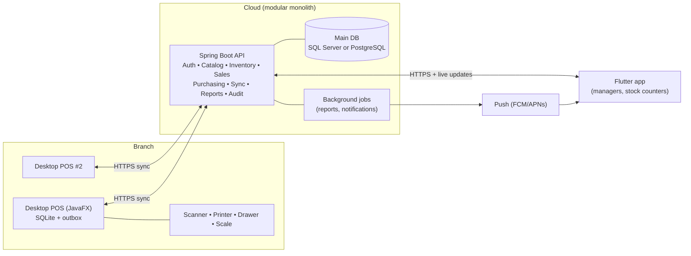

# Universal Retail POS — Critical Analysis & Open Questions

**Document:** 00 — Pre-design review
**Status:** Answered 2026-11-08 — the owner's answers and the resulting scope are recorded in `DECISIONS.md`; where this document differs (e.g. SaaS hosting, PostgreSQL, Arabic), the decisions log wins.
**Date:** 2026-11-08
**Next step:** Owner answers Section 9 → I write the 12 planning deliverables (Markdown + PDF package, diagrams in Mermaid/DBML)

---

## How to read this document

I reviewed your brief as a senior architect, business analyst and UX lead would. Here is what you'll find:

1. **An honest verdict on scope** (Section 1)
2. **Your technology choices reviewed**, with alternatives (Section 2)
3. **Architecture decisions** that need to be made early (Section 3)
4. **Missing requirements**: what real retailers will expect that isn't in the brief (Section 4)
5. **Business-logic traps** that sink POS projects (Section 5)
6. **Security, reliability and money accuracy** (Section 6)
7. **Feature tiers**: essential, recommended and optional (Section 7)
8. **UI/UX direction** (Section 8)
9. **Questions for you**, each with my recommended answer (Section 9)

Wherever I recommend something, I explain it in plain language. A ⚠️ marks a risk. A ✅ marks a recommendation.

---

## 1. Honest verdict on scope

The brief describes what commercial vendors (Lightspeed, Square for Retail, Odoo POS, Loyverse) built with teams of 10–50 engineers over several years. That doesn't mean you can't build it. It means **the order of work decides whether you ship anything.**

| Scope | Rough effort (1 full-time developer working with AI help) |
|---|---|
| **MVP**: backend + desktop POS + offline sync + inventory + basic reports + basic mobile dashboard, for **one** retail type | 6–9 months |
| **Commercial v1**: adds purchases, returns, multi-branch transfers, roles, cash sessions, full mobile app | +6–9 months |
| **Everything in the brief**: all retail types, mobile POS, AI assistant, advanced reports | 18–30 months total |

⚠️ **Biggest project risk:** building 17 desktop modules and 13 mobile modules side by side. You get 30 half-finished modules and nothing a store can use.

✅ **Recommendation:** use a **"vertical slice" roadmap.** First make a single store, with a single terminal, able to sell, print a receipt, survive an internet outage, and see correct stock and cash at day end. Then widen from there. The roadmap deliverable will follow this order.

---

## 2. Technology stack review

### 2.1 Desktop: JavaFX (NetBeans)

| Option | Pros | Cons |
|---|---|---|
| **JavaFX** *(your choice)* | Same language as the backend, so domain code (money, tax and pricing rules) can be **shared** between server and terminal. Good access to printers and serial ports. Mature. | Making it look modern takes deliberate work. Smaller UI-library ecosystem. Touch screens work but aren't excellent out of the box. |
| Flutter Desktop | One UI codebase with the mobile app. Modern look comes easily. | Weaker Windows hardware support (USB printers, cash drawers, scales). Pricing and tax rules would be written twice, once in Dart and once in Java. |
| .NET (WPF/WinUI) | Best Windows POS hardware support (OPOS drivers). | A third language. No code sharing with anything else. |

✅ **Keep JavaFX.** Sharing the pricing, tax and rounding logic between server and terminal is a real financial-accuracy benefit: one implementation instead of two that drift apart. Conditions:
- Use **Maven (multi-module)**, not NetBeans' default Ant project. NetBeans opens Maven projects natively. Only Maven lets the backend and desktop share a `pos-core` library.
- Use **Java 21 LTS**, the **AtlantaFX** theme library as a modern base we restyle, and **jpackage** to ship a Windows installer with Java bundled, so stores don't install Java themselves.
- Design for **Windows first**. Most retail terminals run Windows.

### 2.2 Mobile: Flutter ✅
A good choice. Use **Riverpod** or **Bloc** for state, **Drift** (typed SQLite) for offline storage, **mobile_scanner** for camera barcodes, and **Firebase Cloud Messaging** for push notifications.

### 2.3 Backend: Spring Boot REST ✅, with one warning
⚠️ Don't build microservices. Build a **modular monolith**: one deployable application split internally into clean modules (catalog, inventory, sales, sync, and so on). Microservices would multiply your operational work by ~10× with no benefit at this scale. If a module ever needs to be split out later, the clean boundaries make that possible.

### 2.4 Main database: SQL Server. Needs a decision.

| | SQL Server | PostgreSQL |
|---|---|---|
| Your familiarity (SSMS) | ✅ Yes | Learning curve (pgAdmin/DBeaver) |
| Licence cost | Express is free but **10 GB per database cap, uses ~1 CPU socket**. Standard ≈ US$ 900+ per core / year in the cloud (Azure SQL similar). | Free at any size |
| Cloud hosting (SaaS) | Azure SQL / AWS RDS, more expensive | Every provider, cheap managed options |
| Row-level security (tenant isolation) | ✅ Built in | ✅ Built in |
| Good fit if… | Customers run it **on their own Windows servers** | **You host it** as a cloud SaaS |

✅ **Recommendation:** this depends on Question 2 (deployment model). If you host the system as SaaS, I recommend **PostgreSQL** for cost. If you prefer SQL Server, it is a perfectly sound engine. In both cases I'll write portable SQL and use **Flyway** migrations, so switching later stays possible. *I won't change this without your approval.*

### 2.5 Offline database: SQLite ✅
Correct. On the desktop, add **SQLCipher** (encrypted SQLite) so a stolen terminal doesn't leak customer and sales data.

### 2.6 Communication: REST + sync
REST is right for most operations. Two additions:
- **Sync protocol** over REST: an outbox on the device, idempotency keys, and a change feed from the server (details in Section 3.3).
- **WebSocket or Server-Sent Events** for *Live Sales Monitoring* on mobile. Polling every few seconds also works for MVP.

---

## 3. Architecture decisions to make now

### 3.1 Who hosts it? (Question 2)
"Multiple businesses with isolated data" implies you **sell this as a cloud service (SaaS)** and host one central system for every customer. The alternative is installing a separate copy at each customer. That changes pricing, the database choice, backup responsibility and support. **This is the single most important decision.**

### 3.2 How business data is isolated (multi-tenancy)

| Model | How it works | Verdict |
|---|---|---|
| Shared database, `tenant_id` on every row | One DB. Every query filtered by business. | ✅ **Recommended.** Cheapest and simplest to run. |
| + Row-Level Security | The database itself refuses rows from other tenants, even if the code has a bug | ✅ **Add as a safety net** |
| Database per business | Strongest isolation | Only for large enterprise customers later |

### 3.3 Offline sync: the core idea in plain language

Most POS sync bugs come from treating data as **"current values to overwrite"**. We avoid that:

- **Sales, refunds, payments and stock movements are "receipts in a mailbox".** The terminal writes them locally, then posts them to the server when it can. They are **never edited and never conflict**. A correction is a *new* record (a refund, an adjustment).
- **Stock is not a number that gets overwritten. It is the sum of all movements.** Two offline terminals selling the same item don't conflict: the server adds both sales. Stock might go negative, which real stores handle (see 5.1).
- **Every record gets a unique ID created on the device** (UUID). If the internet drops mid-upload and the terminal sends the same sale twice, the server sees the same ID and ignores the duplicate. That is **duplicate-transaction prevention**.
- **Master data** (products, prices, users) flows mostly *down* from the server. Each record carries a version number. If two managers edit the same product, the server detects it and rejects the second edit instead of silently overwriting.
- **The sale stores the price it was sold at.** A price change made while a terminal was offline never rewrites history.

### 3.4 Branch local server? (Question 8)

| Option | Behaviour when the internet is down | Complexity |
|---|---|---|
| **A. Terminals talk directly to the cloud** | Each terminal works alone and syncs later. Terminals in the same store don't see each other's sales until reconnect. | ✅ Low. **Recommended for v1.** |
| B. Small server in each branch (LAN) | Terminals keep sharing data inside the store | High. Another machine to install, back up and support at every branch |

### 3.5 Proposed high-level architecture

---

## 4. Missing requirements

These are things retailers will expect but the brief doesn't mention. Several of them change the database design, which is why I'm raising them before designing it.

### 4.1 Money, tax and currency ⚠️ affects the database design
- **Tax rules:** VAT/GST rates per product, tax-inclusive vs tax-exclusive pricing, exemptions, and tax shown on receipts.
- **Multi-currency:** many markets price in one currency and accept cash in another (for example USD plus a local currency). That needs exchange rates captured at the moment of sale, change given in a mixed currency, and reports in both currencies. **If your market needs this, it must be in the design from day one.**
- **Rounding rules:** line-level vs invoice-level rounding, and cash rounding to the smallest coin in circulation.
- **Legal invoicing / e-invoicing:** some countries require fiscal printers, gapless invoice numbers, QR codes or real-time reporting to the tax authority. **Question 1.**

### 4.2 Selling features retailers expect
- **Split payments** (part cash, part card), multiple tenders, change calculation
- **Discounts and promotions engine:** line or invoice discount, % or fixed, "buy 2 get 1", bundles, time-limited promos, manager limits on discounts
- **Hold / recall sale** (park a customer's basket and serve the next one)
- **Price override and void line**, each needing permission or manager approval
- **Customer credit accounts** ("pay later" / debt book), with credit limits and statements
- **Loyalty points, gift cards and store credit**
- **Receipt reprint, gift receipts**, and email/WhatsApp receipts

### 4.3 Product data per retail type ⚠️ "universal" is the hard part

| Retail type | Needs that others don't |
|---|---|
| Supermarket | **Weighed items** (scale integration, barcodes with weight/price embedded, EAN-13 prefixes 20–29), **expiry dates and batches**, fast checkout |
| Clothing | **Size × colour matrix** (one style → 30 SKUs), seasons, exchanges |
| Electronics | **Serial numbers / IMEI per unit**, warranties, repairs (optional) |
| All | Units and packs (sell one piece, buy a box of 24), multiple barcodes per product, shelf and label printing |

✅ **Recommendation:** one data model that supports all of these. Each business switches on the **feature packs** it needs (variants, serials, batches/expiry, weighing), so a clothing store never sees expiry-date fields.

### 4.4 Inventory and purchasing
- **Costing method** for profit reports. ✅ I recommend **weighted average cost**. FIFO is more complex and rarely needed for retail POS.
- **Purchase orders → goods receipt → supplier invoice → supplier payment** (what you owe suppliers)
- **Branch-to-branch transfers** with an "in transit" state
- **Stock adjustments with reason codes** (damage, theft, expiry)
- **Stocktake** (full or partial counts, freezing, variance approval)
- **Reorder points** (which also power your "Purchase Recommendations" feature)

### 4.5 Cash control
- Opening float, **cash in/out** (paid-outs), **blind close** (the cashier counts without seeing the expected total), over/short reporting
- **X-report** (mid-shift) and **Z-report** (end of day, sealed)
- Cash drawer opening logged ("no-sale" opens are a classic theft signal)

### 4.6 The software business itself ⚠️ easy to forget
Because you'll *sell* this product, you also need:
- **Subscription plans and licensing:** limits per plan (branches, terminals, users), trial periods, suspending non-paying accounts
- **Device registration:** a terminal must be activated to a branch with a one-time code
- **Customer onboarding:** import products from Excel/CSV, setup wizard
- **A super-admin back office** (for you) to manage customer businesses and support them
- **Remote updates** for desktop terminals

### 4.7 Integrations (decide what's in or out)
- **Card payment terminals:** see Question 9
- **Accounting export** (to an accountant, QuickBooks/Xero, or a general ledger). ✅ I recommend **financial reports + export**, *not* building a full accounting system.
- **E-commerce** (Shopify, WooCommerce stock sync): optional, later

---

## 5. Business-logic traps (and how the design avoids them)

| # | Trap | What goes wrong | Design answer |
|---|---|---|---|
| 5.1 | **Blocking sales when stock is 0** | System says 0, customer is holding the item. Offline terminals can't know the true stock anyway. | ✅ Allow negative stock by default, show a warning, flag it for review. Configurable per business. |
| 5.2 | **Invoice numbers when offline** | Two offline terminals both issue invoice #1001 | Each terminal has its own series: `BR01-T02-000123`. The global ID is a UUID. |
| 5.3 | **Device clocks are wrong** | Sales dated 2019, reports broken | Store both device time and server receive time. Flag large clock drift. |
| 5.4 | **Floating-point money** | 0.1 + 0.2 = 0.30000000000000004 | `BigDecimal` in Java, `DECIMAL(19,4)` in the database, explicit rounding rules. No `double`, ever. |
| 5.5 | **Editing or deleting a completed sale** | Destroys the audit trail, enables fraud | Completed sales are immutable. Corrections are voids, refunds or adjustments, each audited. |
| 5.6 | **Refund more than paid / refund twice** | Cash loss | Each return links to the original sale line. The server tracks the quantity already returned. Refunds go to the original tender by default. |
| 5.7 | **Mobile manager approval while terminal is offline** | The cashier is stuck | The approval request goes to the phone when online. Fallback: a manager PIN at the terminal. Both are audited. |
| 5.8 | **Price changes mid-shift** | Receipt and report don't match | The sale line stores the price, tax and cost at the moment of sale. |
| 5.9 | **Cost of items sold offline** | Profit report is wrong | Cost is recalculated on the server when the sale syncs, and the report marks provisional figures. |
| 5.10 | **Shift closed with sales still unsynced** | Z-report totals are incomplete | The Z-report is generated on the terminal (always complete for that terminal). The branch-level report shows "N terminals not yet synced". |

---

## 6. Security, reliability and accuracy

**Security**
- Passwords hashed with **Argon2/bcrypt**. Cashiers log in at the till with a **PIN** (fast user switching). Managers and owners use a password + optional 2FA on mobile.
- **Access + refresh tokens** (JWT) per user and **a credential per registered device**. A stolen or lost device can be revoked remotely.
- Offline login works using cached, hashed PINs, with a time limit on offline operation (e.g. 72 h, configurable).
- **Never store card numbers.** Staying out of card-data storage keeps you out of most PCI-DSS obligations.
- Encrypted SQLite on terminals, HTTPS everywhere, and secrets kept out of code.
- **Tamper-evident audit log:** each entry includes a hash of the previous one, so a deleted or altered entry is detectable.

**Reliability & recovery**
- Server backups: full nightly + transaction-log backups every 5–15 min, giving **point-in-time restore**. Copies are stored off-site, and restores are tested monthly. (Backups that have never been restored are hopes, not backups.)
- Proposed targets for you to approve: **RPO ≤ 15 min** (max data loss) and **RTO ≤ 4 h** (max downtime) for the cloud. Terminals keep selling during any cloud outage.
- Terminals keep local data until the server confirms receipt, and warn loudly if unsynced data is older than X hours.

**Concurrency**
- Optimistic locking (version columns) on master data. Database transactions around every financial write. Unique constraints as the final guard against duplicates.

**Testing:** money, tax and sync logic gets the most automated tests, including a **"chaos" test suite**: kill the network mid-sync, send duplicates, sell the same item offline on two terminals, and check that totals still reconcile exactly.

---

## 7. Feature tiers

**🟥 Essential (MVP, without these it's not a POS)**
Sell (scan / search / quick keys), split payments, receipts, cash drawer, offline selling + sync, duplicate prevention, products/categories/barcodes/units, stock movements ledger, basic tax, cash sessions with X/Z reports, users, roles and PIN login, returns against a receipt, audit log, daily sales report, single branch → multi-branch, mobile dashboard + live sales.

**🟧 Recommended (commercial v1, needed to compete)**
Variants matrix, purchases and suppliers with payables, transfers between branches, stocktake (mobile), discounts and promotions, customer accounts and credit, manager approvals on mobile, push notifications, purchase recommendations (reorder points), product import, label printing, subscription/licensing, setup wizard, multi-currency (*essential* if your market needs it).

**🟦 Optional / advanced (later)**
Serial/IMEI tracking, batches and expiry, scales, loyalty and gift cards, e-commerce sync, accounting integrations, customer-facing display, mobile POS, AI business assistant, branch local server, integrated card payments.

---

## 8. UI/UX direction

A POS is used **8 hours a day under pressure**, often by staff with little training. Professional POS design is about **speed, error prevention and calm**, not decoration. My principles:

1. **Keyboard- and scanner-first, touch-friendly.** Every cashier action works without a mouse. Touch targets are ≥ 48 px.
2. **The total is sacred.** The amount due is always the largest, clearest thing on screen, in tabular (monospaced) digits.
3. **Colour is meaning, never decoration.** Green = money in, amber = needs attention, red = destructive or void. Everything else stays neutral.
4. **Two densities:** a *cashier mode* (big, minimal, fast) and a *back-office mode* (dense tables, filters, bulk actions).
5. **Mistakes are recoverable:** an undo for the last scan, confirmations only for destructive actions, and offline/sync status always visible but never alarming.
6. **Light and dark themes**, and **RTL layout** if Arabic is needed (it changes every screen, so it has to be planned in).
7. **One design system** across desktop and mobile: same tokens, icons and component names, documented so screens stay consistent as the product grows.

I'll offer **three distinct visual directions** (Question 17). Your choice becomes the design-system document, with screen mockups once the documents are approved.

---

## 9. Questions for you

Each question has my **recommended answer (★)**. Reply in any form you like. "Q3: B, Q6: keep SQL Server, rest as recommended" is enough.

### A. Business & market (most important)

**Q1. Which country or countries will you sell in first?**
This decides tax rules, e-invoicing law, currencies and languages.
→ Please name the country. Also: is **dual currency** used there (e.g. USD + local)? Is **e-invoicing or a fiscal printer** legally required?

**Q2. How will customers use the system?**
- **A ★ Cloud SaaS:** you host one system and businesses subscribe monthly
- B On-premise: you install a server at each customer
- C Both (much more work, not recommended for v1)

**Q3. Which retail type should the MVP target first?**
- **A ★ Minimarket / general retail** (largest market, simplest products)
- B Clothing (needs the variants matrix in the MVP)
- C Electronics (needs serial numbers in the MVP)
- D Full supermarket (needs scales, weighed barcodes and expiry in the MVP)

**Q4. Who is building this, and with what budget?**
Solo or a team? Full-time or part-time? Is there a target launch date? What monthly budget is acceptable for hosting and licences (e.g. US$ 50 / 200 / 1000)?

**Q5. Product name?** (Needed for branding, the design system and package names. A working name is fine.)

**Q6. Languages?**
- **A ★ English + Arabic (RTL)** from the start
- B English only now, translation-ready
- C Other (please list)

### B. Technology

**Q7. Main database?**
- **A ★ PostgreSQL** if Q2 = SaaS (free, cheapest hosting)
- B Keep **SQL Server** (your familiarity; higher cloud cost)

**Q8. Desktop technology?**
- **A ★ Keep JavaFX** (Maven multi-module, Java 21, shared core library with the backend)
- B Switch to Flutter Desktop (one UI codebase, weaker hardware support)

**Q9. Card payments in v1?**
- **A ★ Non-integrated:** the cashier types the card amount into a separate bank terminal and records it in the POS (no card data touches our system)
- B Integrated with a specific payment provider (please name it, since it depends on your country)

**Q10. Branch local server?**
- **A ★ No:** terminals sync directly to the cloud (Section 3.4)
- B Yes: a LAN server per branch

**Q11. Hardware you expect to support first?**
- **A ★** 80 mm ESC/POS thermal printer (USB/network), cash drawer through the printer, USB barcode scanner (keyboard mode)
- Plus: label printer? scale? customer display? (please list)

### C. Business rules

**Q12. Selling an item whose system stock is zero?**
- **A ★ Allow with warning**, configurable per business
- B Block (not recommended; breaks offline selling)

**Q13. Cost method for profit reports?**
- **A ★ Weighted average cost**
- B FIFO

**Q14. Customer credit ("pay later" / debt accounts)?**
- **A ★ Yes, in commercial v1** (common and important in many markets)
- B Not needed

**Q15. Returns policy defaults?**
- **A ★** Returns with receipt only by default, refund to the original payment method; returns without a receipt allowed only with a manager approval and only as store credit
- B Different: please describe

**Q16. Mobile POS (selling from the phone)?**
- **A ★ Later phase**, after the desktop POS is stable
- B Required in the MVP

### D. Design & documents

**Q17. Visual direction** (choose one; I'll build the design system around it):
- **A ★ "Ledger":** calm and editorial. Warm off-white / deep ink, one confident accent (deep teal), generous typography, tabular numerals. Feels premium and trustworthy, like a banking product.
- B "Console": dark-first and high-contrast, built for long shifts and dim stores. Electric accent colour, dense data, a pro-tool feel.
- C "Market": bright and friendly, rounded shapes, colour-coded categories. Approachable for small shops and staff with little training.
- (Or: do you have brand colours or a logo already?)

**Q18. Documents:**
- Language of the documents: English? Arabic? Both?
- ✅ I'll deliver each document as **Markdown** + one combined **PDF package**, diagrams in **Mermaid** and the database in **DBML** (editable in dbdiagram.io), as you asked.

---

## 10. What happens after you answer

1. I record your answers in `DECISIONS.md` (each decision with its reason and date).
2. I write the 12 deliverables in this order, because each depends on the previous ones: SRS → Architecture → Roles & Permissions → Database/ERD → Table reference → Offline sync → API → Desktop screens → Mobile screens → Folder structure → Testing → Roadmap.
3. I export the PDF package and send it to you for review. **No code is written until you approve.**
