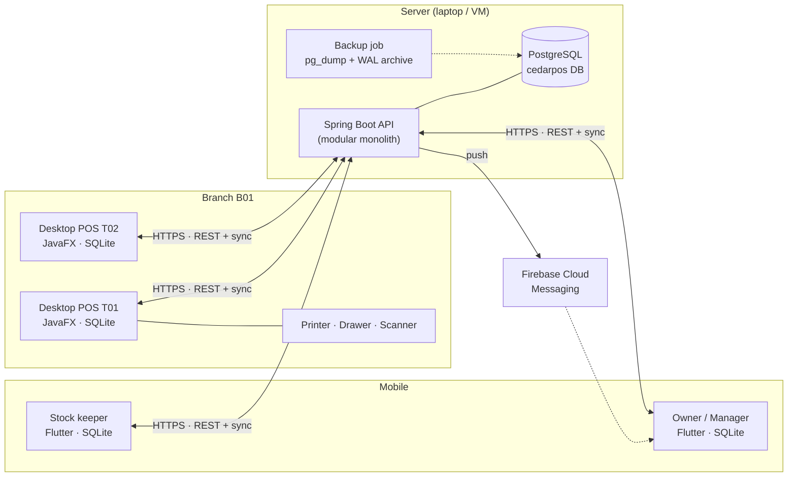
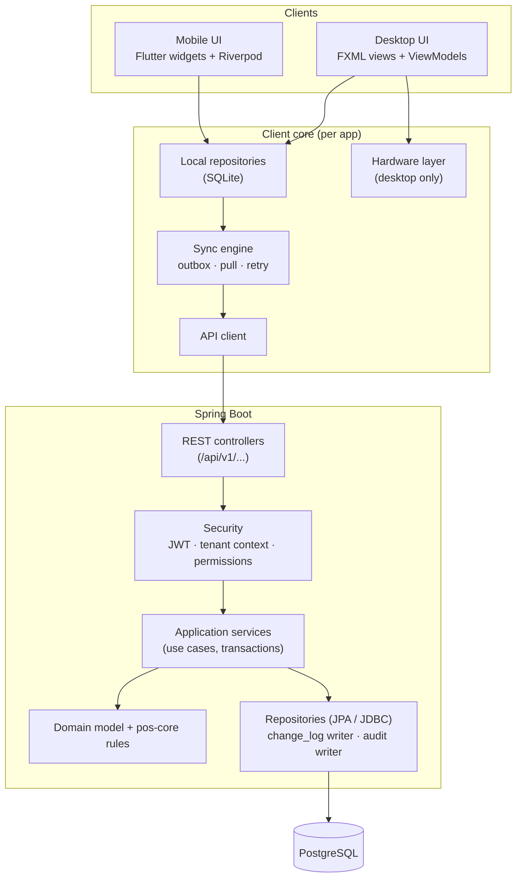
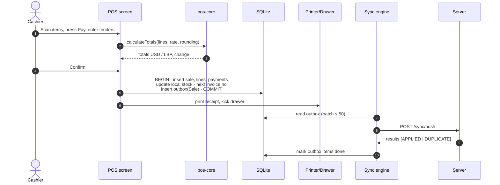
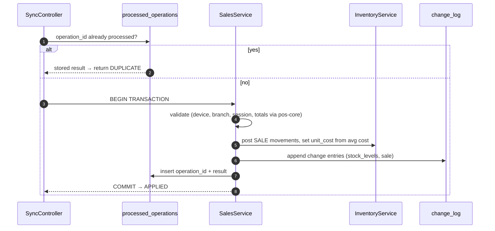
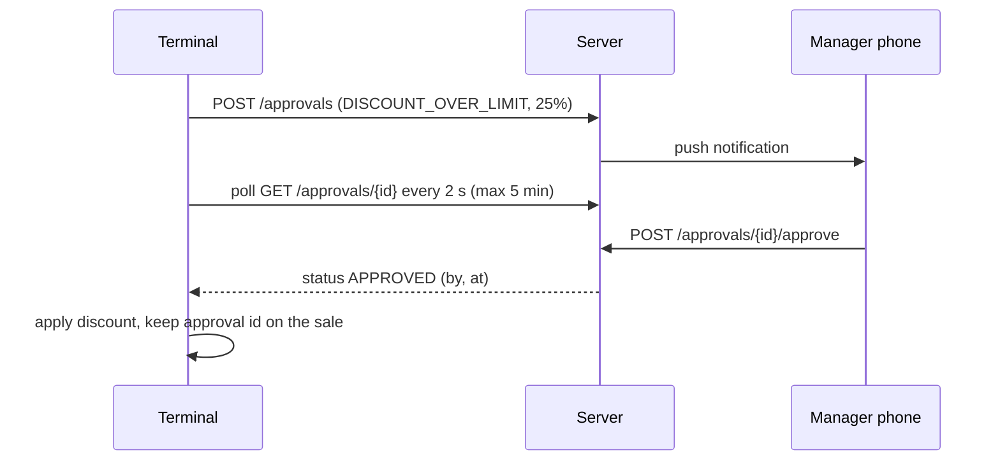

# 02 — System Architecture

**Product:** Cedar POS · **Version:** 1.0 (planning) · **Date:** 2026-11-08

---

## 1. Architecture at a glance

**In plain words:** one server holds the real data. Every desktop and phone keeps a local copy of what it needs, works on that copy when the network is down, and exchanges changes with the server through two sync endpoints (*push* my new records, *pull* what changed).

---

## 2. Architectural decisions

| # | Decision | Why | Alternative rejected |
|---|---|---|---|
| A1 | **Modular monolith** backend (one Spring Boot app, internal modules) | One developer, one deployable, simple debugging; modules can be split later | Microservices — 10× operations work, no benefit at this size |
| A2 | **Shared Java library `pos-core`** used by server and desktop | Money, rounding, tax and invoice-total calculation written once → receipts and server always agree | Duplicate logic in both apps |
| A3 | **UUIDs created on the device** for all synced records | Records can be created offline without asking the server for an ID; also the idempotency key that prevents duplicates | Auto-increment IDs (need server, collide offline) |
| A4 | **Append-only transactions** (sales, returns, payments, movements, cash events) | They never conflict during sync; full audit trail | Updatable records (conflicts, lost history) |
| A5 | **Master data online-only** (products, prices, users, settings) | Avoids edit/edit conflicts; offline needs are covered by operations | Bidirectional offline editing (weeks of conflict-resolution work) |
| A6 | **Change feed** (`change_log` with a global sequence number) for pull sync | Devices ask "what changed since #N" — simple, reliable, resumable | Timestamps (clock problems), full re-downloads |
| A7 | **PostgreSQL** + **Flyway** migrations | Most-used database among professional developers (Stack Overflow 2025), free at any size, standard on every cloud; Flyway makes schema changes repeatable | SQL Server — fine engine, but licence cost outside the free editions and less common in new projects (decision D-009) |
| A8 | **REST/JSON** + polling for live data (15 s) | Easy to build, test (Swagger) and debug | WebSockets (later, if needed) |
| A9 | **JWT access token (15 min) + refresh token (30 days)**, per device | Works for desktop and mobile; revocable via refresh token + device deactivation | Server sessions/cookies |
| A10 | **Desktop without Spring** (plain JavaFX + small DI) | Fast startup (< 3 s), small installer | Spring Boot inside the desktop app |

---

## 3. Logical layers

---

## 4. Backend modules

Each module is a Java package with its own `api` (controllers, DTOs), `application` (services), `domain` (entities, rules) and `infrastructure` (repositories). Modules talk to each other only through application services — never directly to another module's tables.

| Module | Responsibility | Main tables |
|---|---|---|
| `identity` | Login, PIN, tokens, users, roles, permissions | users, roles, permissions, role_permissions, user_branches, refresh_tokens |
| `organization` | Business, branches, devices, cash registers, settings | businesses, branches, devices, cash_registers, business_settings |
| `currency` | Currencies, exchange rates | currencies, exchange_rates |
| `catalog` | Categories, products, variants, attributes, units, packagings, barcodes, prices, taxes | categories … variant_prices, tax_rates |
| `inventory` | Movements, stock levels, adjustments, counts, transfers, average cost | stock_movements, stock_levels, stock_adjustments, stock_counts, stock_transfers (+ lines) |
| `purchasing` | Suppliers, purchases, supplier payments, recommendations | suppliers, purchases, purchase_lines, supplier_payments |
| `sales` | Sales, lines, payments, returns, refunds, voids | sales, sale_lines, sale_payments, returns, return_lines, return_refunds |
| `customers` | Customers, credit ledger, payments | customers, customer_ledger_entries, customer_payments |
| `cash` | Cash sessions, cash movements, X/Z data | cash_sessions, cash_movements |
| `expenses` | Expense categories, expenses | expense_categories, expenses |
| `approvals` | Approval requests and decisions | approval_requests |
| `notifications` | In-app notifications, push via FCM | notifications, push_tokens |
| `reporting` | Read-only queries for dashboard and reports | (reads all; optimized SQL views) |
| `sync` | Push/pull endpoints, idempotency, change feed, sync issues | processed_operations, change_log, device_sync_state, sync_issues |
| `audit` | Append-only audit trail | audit_logs |

**Cross-cutting:** `TenantContext` (business id + allowed branches from JWT), `@RequiresPermission` annotation, global error handler (RFC 7807 problem details), request-id logging, OpenAPI docs.

---

## 5. Technology stack (final)

| Layer | Technology | Notes |
|---|---|---|
| Language (server + desktop) | **Java 25 LTS** runtime (code compiled with `--release 21`, so it builds on JDK 21+) | |
| Build | **Maven** multi-module (`pos-core`, `pos-server`, `pos-desktop`) | Opens natively in NetBeans |
| Backend | **Spring Boot 4.x**: Web, Validation, Security, Data JPA, Actuator | |
| DB access | Spring Data JPA (master data) + `JdbcTemplate` (reports, bulk sync) | |
| Database | **PostgreSQL 18**; managed with pgAdmin 4 / DBeaver | `org.postgresql` JDBC driver |
| Migrations | **Flyway** (`db/migration/V1__baseline.sql` …) | |
| Auth | Spring Security + JWT (`jjwt`), bcrypt | |
| API docs | **springdoc-openapi** (Swagger UI at `/swagger-ui`) | |
| Desktop UI | **JavaFX 21**, FXML, **AtlantaFX** base theme + custom "Ledger" CSS | |
| Desktop local DB | **SQLite** (`sqlite-jdbc`), plain JDBC repositories, own migration runner | SQLCipher = Could |
| Desktop HTTP / JSON | `java.net.http.HttpClient` + Jackson | |
| Printing | **escpos-coffee** (ESC/POS), fallback: JavaFX print / PDF (OpenPDF) | |
| Packaging | `jpackage` → Windows `.msi` with bundled runtime | |
| Mobile | **Flutter 3.x**, Dart 3 | |
| Mobile state | **Riverpod** | |
| Mobile local DB | **Drift** (typed SQLite) | |
| Mobile networking | **Dio** + interceptors (auth, retry) | |
| Navigation | **go_router** with role guards | |
| Barcode camera | **mobile_scanner** | |
| Charts | **fl_chart** | |
| Push | **firebase_messaging** (FCM) | Should |
| Testing | JUnit 5, AssertJ, Mockito, Spring Boot Test, Testcontainers (PostgreSQL) / dedicated test DB, TestFX (smoke), Flutter test | document 11 |
| CI | GitHub Actions: build + test on every push | Should |

---

## 6. Key runtime flows

### 6.1 Completing a sale (desktop, online or offline — same code path)

The sale is "done" for the cashier at step 4. Steps 6–9 happen in the background, seconds later or hours later.

### 6.2 Server processing of a pushed sale

If validation finds a business problem that cannot be undone in the real world (e.g. over-return), the record is still saved and a `sync_issue` is created for a manager — **money and goods already moved, so the data must reflect reality.** Only technically invalid payloads (malformed JSON, unknown device) are rejected.

### 6.3 Manager approval via mobile

If the terminal is offline, the "Ask on phone" button is disabled and the manager-PIN option is used.

---

## 7. Deployment

### 7.1 Development / demo (recommended for the internship)

| Component | Where |
|---|---|
| PostgreSQL 18 + pgAdmin 4 | Developer laptop (Windows installer or Docker) |
| Spring Boot server | Same laptop, `java -jar pos-server.jar`, port 8443 (HTTPS, self-signed cert) or 8080 on LAN |
| Desktop POS | Same laptop and/or a second PC on the same Wi-Fi |
| Mobile app | Android phone on the same Wi-Fi (server URL configured at first launch, e.g. `https://192.168.1.20:8443`) |

**Demo tip:** turning off the laptop's Wi-Fi sharing (or stopping the server) is an easy, convincing offline demo.

### 7.2 Optional: internet deployment
A small Linux VM or a managed PostgreSQL service (any major cloud) + a domain + Let's Encrypt certificate. Not required for the internship; the architecture does not change.

### 7.3 Environments & configuration
`application-dev.yml`, `application-test.yml`, `application-prod.yml`; secrets (DB password, JWT key) from environment variables, never committed.

---

## 8. Security architecture

| Concern | Measure |
|---|---|
| Authentication | bcrypt (cost 12) for passwords & PINs; JWT signed with HS256 key from env (RS256 = Could) |
| Device trust | Device activation code (one-time, 10-minute expiry) → server issues device id + device secret (stored hashed); every request carries device id; deactivated device → 401 |
| Authorization | Permission codes checked on every endpoint (`@RequiresPermission("pos.sell")`); branch scope checked against `user_branches` |
| Tenant isolation | `business_id` taken **only** from the token, never from request body; repository base class adds the filter; integration tests per module |
| Transport | HTTPS outside localhost; certificate pinning on mobile = Could |
| Data at rest | SQLite on desktop holds only its branch data; Windows user-profile permissions; SQLCipher = Could. Mobile: Drift DB in app sandbox; tokens in `flutter_secure_storage` |
| Input | Bean validation on all DTOs; parameterized SQL only |
| Abuse | Login rate limiting; account lockout (FR-AUTH-04) |
| Audit | Audit writer called by application services (not by controllers) so no path skips it |
| Cards | No card data stored — only method, amount, last-4 (optional) and bank reference |

---

## 9. Reliability, backup and recovery

| Risk | Mitigation |
|---|---|
| Network failure | Offline mode; outbox retries with exponential backoff (5 s → 10 s → … max 5 min) |
| Duplicate submissions | Device-generated UUID + `processed_operations` table + unique constraints (`sales.id`, `sales.invoice_no`) |
| Server crash mid-request | DB transaction rolls back; client retries; idempotency returns the same result |
| Desktop crash mid-sale | Local SQLite transaction — sale either fully saved or not at all; cart auto-saved as a draft every change |
| Terminal disk loss | Unsynced data is the only exposure → sync every 30 s; warning if oldest unsynced record > 1 h; local daily SQLite backup copy |
| Server DB loss | Nightly `pg_dump -Fc` + continuous **WAL archiving** (point-in-time recovery); copy to a second disk/cloud folder; restore tested and documented (`scripts/backup/RESTORE.md`) |
| Clock drift | Server records `received_at`; device sends its clock with each push; drift > 5 min → warning on terminal + sync issue |
| Concurrent edits (master data) | `version` column + optimistic locking → HTTP 409 with current data |
| Concurrent stock updates on server | Single transaction updates `stock_levels` with an atomic `UPDATE … RETURNING` (row lock); movements inserted in the same transaction |

---

## 10. Scalability notes (honest)

The target for this project is **a few branches, ~10 devices, ~100k sales**. The design handles that comfortably on one laptop. For later growth: add indexes from real query plans, move reports to read replicas or pre-aggregated tables, switch polling to WebSockets, and partition `stock_movements` / `sales` by date. None of these require changing the core design.
