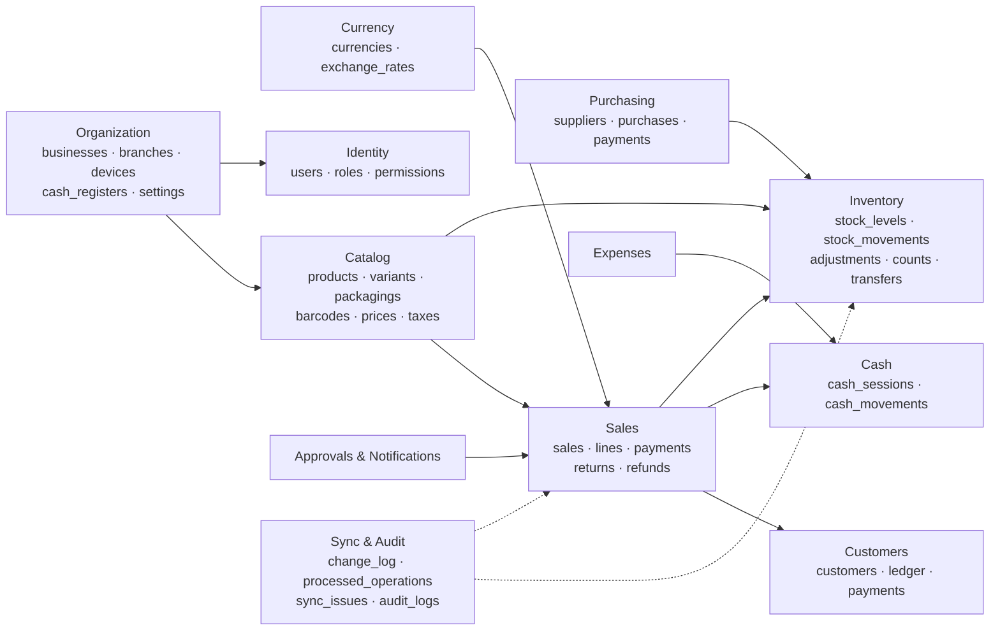
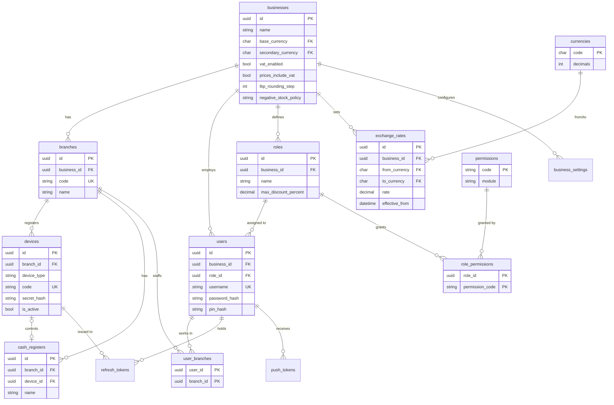
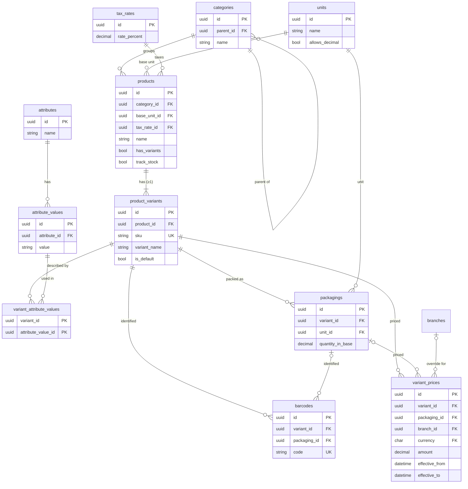
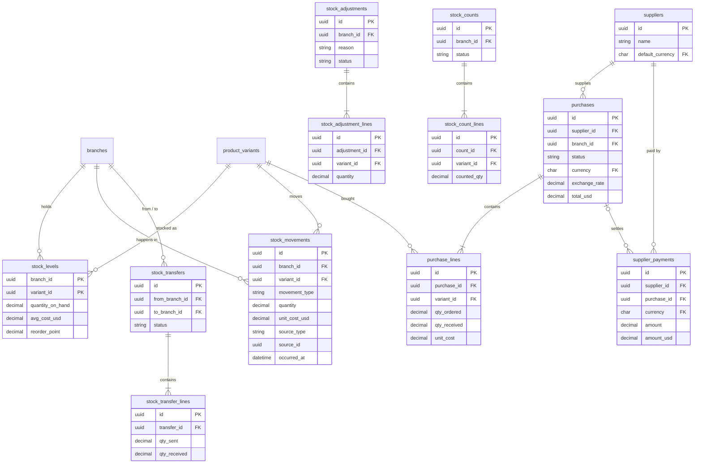
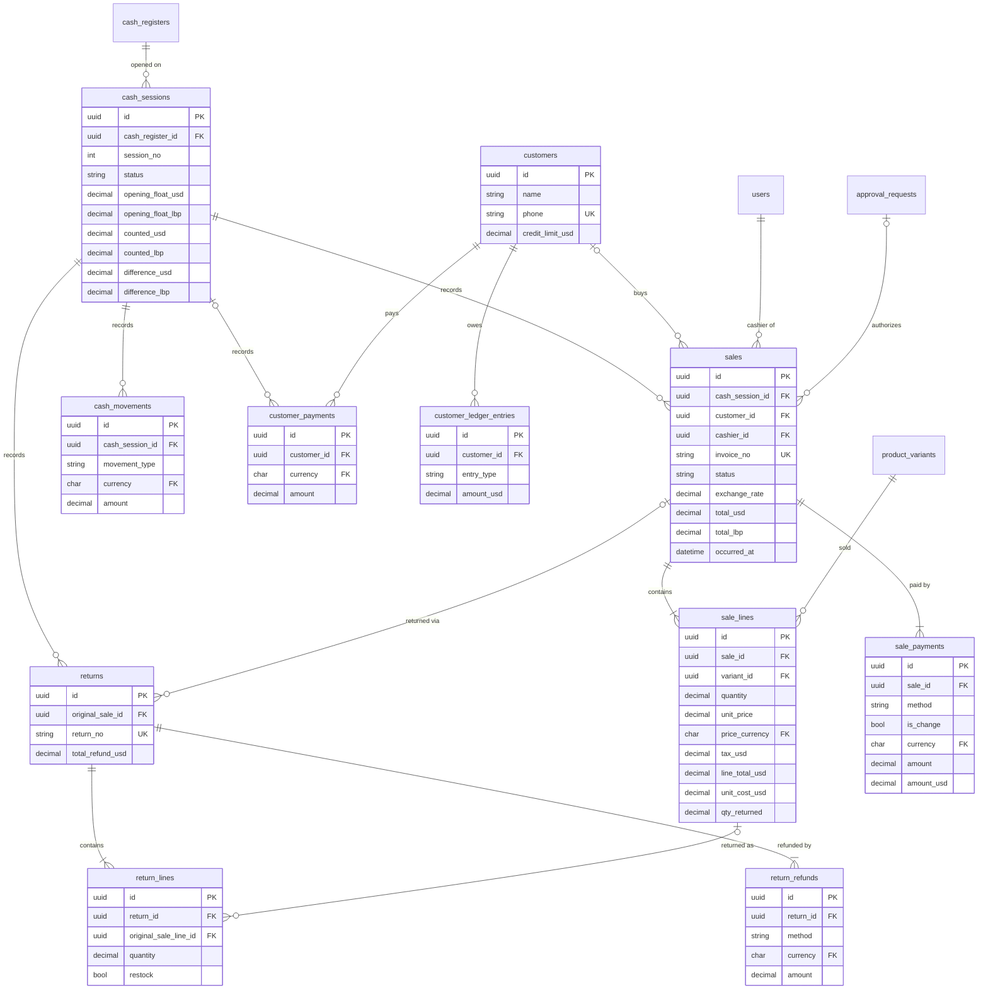
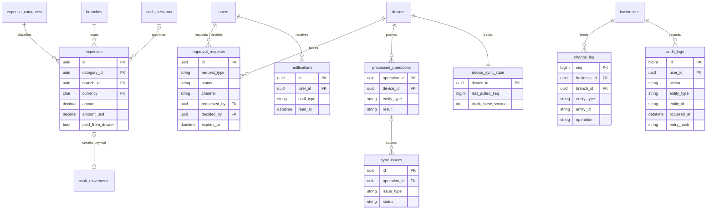

# 04 — Database Design and ERD

**Product:** Cedar POS · **Version:** 1.0 (planning) · **Date:** 2026-11-08
**Engine:** PostgreSQL 18 (central) · SQLite (desktop & mobile local)
**Editable sources:** `database/cedar_pos.dbml` (dbdiagram.io) · Mermaid blocks in this document (`diagrams/*.mmd`)

---

## 1. Design principles

| # | Principle | What it means in practice |
|---|---|---|
| P1 | **Every row belongs to a business** | `business_id` on every top-level table; child tables (lines) inherit it through their parent. All queries filter by it. |
| P2 | **UUID primary keys** (`uuid`, generated as time-ordered UUIDv7 by the app/device) | Devices create IDs offline; the same ID is the duplicate-protection key. *(UUIDv7 is time-ordered, so B-tree indexes stay compact.)* |
| P3 | **Facts are append-only** | `sales`, `sale_lines`, `sale_payments`, `returns*`, `stock_movements`, `cash_movements`, ledger entries, `audit_logs` are never updated or deleted (except server-maintained fields like `qty_returned`, `unit_cost_usd`). |
| P4 | **Snapshots at transaction time** | Names, prices, tax rates, costs and exchange rates are copied onto the transaction so history never changes when master data changes. |
| P5 | **Money = original + rate + USD** | Every monetary record holds `currency`, `amount`, `exchange_rate`, `amount_usd`. |
| P6 | **Stock = ledger + running total** | `stock_movements` is the truth; `stock_levels` is a fast running total updated in the same transaction. A nightly check verifies they match. |
| P7 | **Soft delete for master data** | `is_active = 0` instead of DELETE, because old sales still reference the product. |
| P8 | **Optimistic locking** | `version` column on editable master data; update fails with 409 if someone else changed it first. |
| P9 | **UTC everywhere** | `timestamptz` (stored UTC); converted to Beirut time only for display and day boundaries. |
| P10 | **Constraints in the database, not only in code** | Foreign keys, unique keys and CHECK constraints are the last line of defence. |

**Size:** 57 tables in 12 groups.

---

## 2. Domain map



---

## 3. ERD — Organization, identity, currency



---

## 4. ERD — Catalog



**Why every product has a variant:** stock, prices, barcodes and sale lines always point to `product_variants`. A simple product ("Coca-Cola 330 ml") has one hidden default variant. A clothing product has many. One code path handles both — no special cases.

---

## 5. ERD — Inventory and purchasing



`stock_movements.source_type + source_id` is a **polymorphic link** to the document that caused the movement (sale, return, purchase, adjustment, transfer, count). It is not a database FK (it points to different tables), so integrity is guaranteed by the service layer and verified by tests and the nightly reconciliation job.

---

## 6. ERD — Sales, returns, cash, customers



---

## 7. ERD — Expenses, approvals, notifications, sync, audit



---

## 8. Integrity rules enforced in PostgreSQL

| Rule | Implementation |
|---|---|
| Invoice numbers unique per business | `UNIQUE (business_id, invoice_no)` on `sales`; same for `returns.return_no`, `purchases.reference_no` |
| A sale cannot be pushed twice | PK `sales.id` (device UUID) + `processed_operations.operation_id` PK |
| One open session per register | Partial unique index: `CREATE UNIQUE INDEX … ON cash_sessions (cash_register_id) WHERE status = 'OPEN'` |
| Barcode unique | `UNIQUE (business_id, code)` on `barcodes` |
| Customer phone unique when present | Partial unique index `WHERE phone IS NOT NULL` |
| Positive amounts | `CHECK (amount > 0)` on payments/refunds (except `is_change = 1` → `amount < 0`), `CHECK (rate > 0)` |
| Valid enums | `CHECK (status IN (...))` on every status/type column (plain `varchar` + CHECK instead of PostgreSQL `ENUM`, so adding a value is a simple migration) |
| Movement never zero | `CHECK (quantity <> 0)` on `stock_movements` |
| Transfer to another branch | `CHECK (from_branch_id <> to_branch_id)` |
| Category depth ≤ 2 | Service rule + test (SQL can't express it simply) |
| Sale totals correct | Service recomputes with `pos-core` on ingest; mismatch > $0.01 → `sync_issue` (TOTAL_MISMATCH) |
| Stock running total correct | Nightly job: `stock_levels.quantity_on_hand = SUM(stock_movements.quantity)`; mismatch → alert |
| Append-only tables | Application has no update/delete code paths; the app's DB role has `DELETE` revoked on fact tables (`REVOKE DELETE ON sales, … FROM cedarpos_app`) |

### 8.1 Concurrency on stock (two sales of the same item at the same moment)
```sql
-- inside the sale-ingest transaction, per line:
UPDATE stock_levels
   SET quantity_on_hand = quantity_on_hand - :qty,
       version          = version + 1,
       last_movement_at = now()
 WHERE branch_id = :branch AND variant_id = :variant
RETURNING quantity_on_hand, avg_cost_usd;
-- (if no row: INSERT … ON CONFLICT (branch_id, variant_id) DO UPDATE …)
-- then INSERT INTO stock_movements (…, qty_after = <returned qty>, unit_cost_usd = <returned avg cost>)
```
PostgreSQL locks the row during the `UPDATE`, so two simultaneous sales are applied one after the other; both succeed and the running total is exact.

### 8.2 Isolation level
PostgreSQL's default `READ COMMITTED` with MVCC: readers (reports, mobile dashboard) never block writers (sales ingest) and vice versa — no extra setting needed.

---

## 9. Local databases (SQLite)

Local databases hold **a branch-scoped copy** of master data plus the device's own **unsynced work**. They are not full replicas.

### 9.1 Desktop POS (`cedarpos-local.db`)

| Group | Tables | Source |
|---|---|---|
| Reference (pulled) | `branch`, `business_settings`, `users_cache` (with PIN hash, role, permissions), `currencies`, `exchange_rate_current`, `tax_rates`, `units`, `categories`, `products`, `product_variants`, `packagings`, `barcodes`, `prices_current` (resolved for this branch), `customers`, `stock_levels` (this branch) | Pull sync |
| Own transactions | `sales`, `sale_lines`, `sale_payments`, `returns`, `return_lines`, `return_refunds`, `cash_sessions`, `cash_movements`, `customer_payments`, `stock_adjustments(+lines)`, `approvals_local` | Created locally, pushed |
| Recent history (pulled) | `sales_history` (last 30 days from all terminals of the branch — for returns and reprints) | Pull sync |
| Terminal-only | `held_sales`, `cart_draft`, `local_sequences` (invoice / return / Z counters) | Never synced |
| Sync | `outbox`, `sync_state` (last_pulled_seq, last success), `sync_log` | — |

Local IDs are the **same UUIDs** used on the server; no mapping table is needed.

### 9.2 Mobile (`cedarpos-mobile.db`, Drift)

| Group | Tables |
|---|---|
| Reference | `products`, `variants`, `barcodes`, `prices_current`, `stock_levels` (user's branches), `branches`, `me` (user + permissions), `open_purchases` (ORDERED/PARTIAL purchases + lines for receiving), `exchange_rate_current` |
| Own work | `stock_counts`, `stock_count_lines`, `stock_adjustments`, `stock_adjustment_lines`, `purchase_receipts_local` (goods received by scanning) |
| Snapshots | `dashboard_snapshot` (JSON + fetched_at), `reports_cache`, `notifications` |
| Sync | `outbox`, `sync_state` |

### 9.3 The outbox table (both apps)

| Column | Purpose |
|---|---|
| `id` (UUID) | Operation id → server idempotency key |
| `entity_type` | `SALE`, `RETURN`, `CASH_SESSION_OPEN`, `CASH_SESSION_CLOSE`, `CASH_MOVEMENT`, `CUSTOMER_PAYMENT`, `STOCK_ADJUSTMENT`, `STOCK_COUNT_LINES`, `STOCK_COUNT_SUBMIT`, `PURCHASE_RECEIPT` (mobile) |
| `entity_id` | UUID of the aggregate |
| `payload_json` | Full aggregate (e.g. sale + lines + payments) |
| `created_at` | Device time — keeps order |
| `status` | `PENDING`, `SENDING`, `DONE`, `FAILED` |
| `attempts`, `last_error`, `next_attempt_at` | Retry with backoff |

---

## 10. Migrations

| Item | Approach |
|---|---|
| Server | **Flyway**, files in `pos-server/src/main/resources/db/migration`: `V1__baseline_schema.sql`, `V2__seed_permissions_roles.sql`, `V3__seed_currencies_units.sql`, `V4__...`. Never edit an applied migration; always add a new one. |
| Demo data | `R__demo_data.sql` (repeatable, dev profile only): 2 branches, 4 devices, 8 users, 500 products incl. variants, 90 days of sales. |
| Desktop SQLite | `pos-desktop/src/main/resources/local-migrations/001_init.sql …`; a `schema_version` table; the app migrates on start-up before showing the login screen. |
| Mobile | Drift `schemaVersion` + `MigrationStrategy` with step-by-step migrations. |
| Compatibility | Sync payloads carry `schemaVersion`; the server accepts the current and previous version so an older terminal can still upload its offline sales after a server update. |

---

## 11. Backup and recovery (database part)

| What | How | Frequency |
|---|---|---|
| Logical backup | `pg_dump -Fc cedarpos > cedarpos_YYYYMMDD.dump` (compressed, restorable per table) | Daily 02:00 |
| Point-in-time recovery | `archive_mode = on` + `archive_command` copying WAL files to a backup folder; weekly `pg_basebackup` | Continuous (RPO ≤ 15 min via `archive_timeout = 900`) |
| Off-machine copy | Robocopy / rclone to second disk or cloud folder | After each backup |
| Verification | Monthly restore to `cedarpos_restore_test` (`pg_restore`) + row-count check script | Monthly |
| Scheduler | Windows Task Scheduler (or cron in Docker/Linux) running `scripts/backup/*.ps1` | — |
| Desktop | Copy of `cedarpos-local.db` (SQLite online backup API) on app close and daily; 7 kept | Daily |

Scripts: `scripts/backup/backup-daily.ps1`, `archive-wal.ps1`, `restore-point-in-time.md`, `RESTORE.md`.
