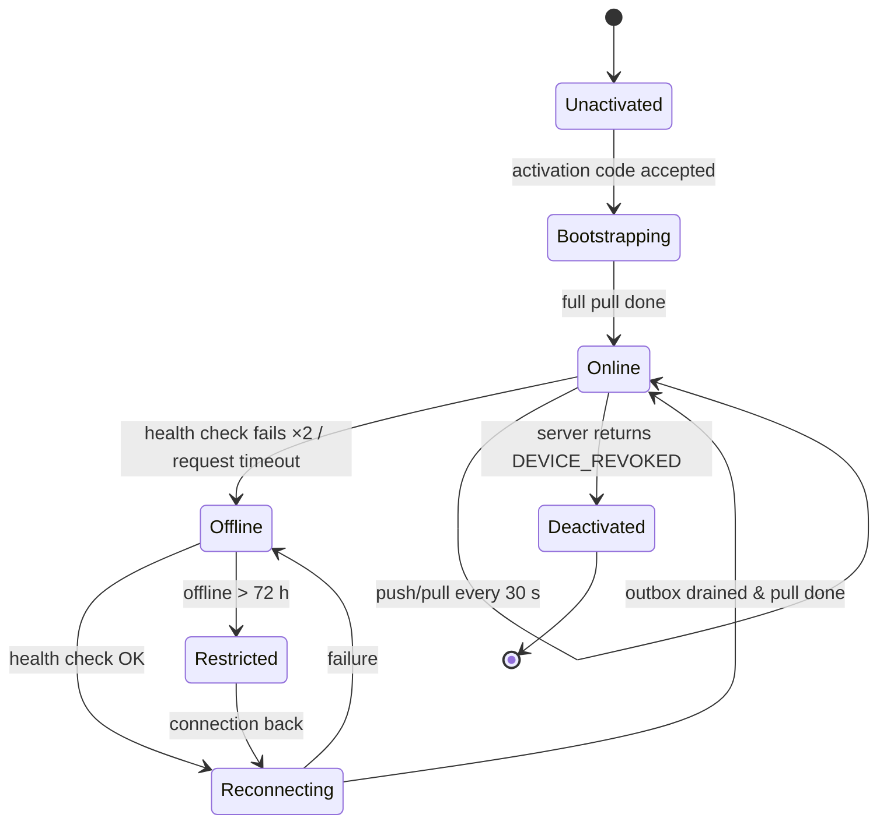
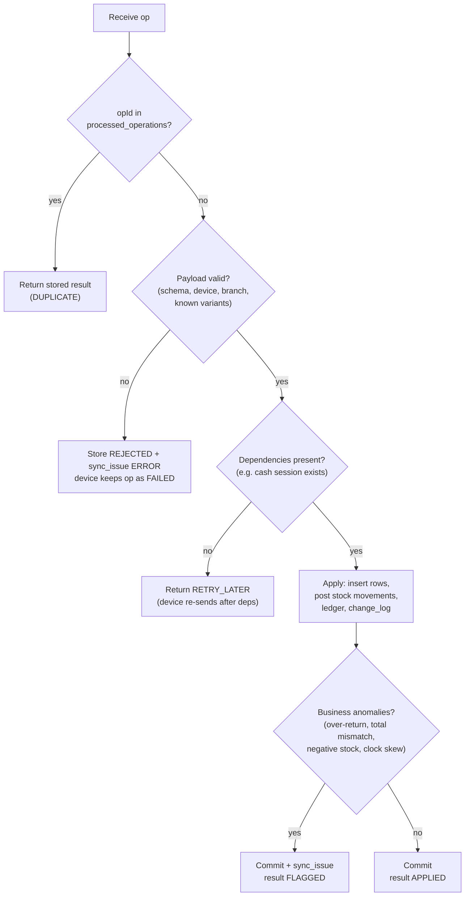
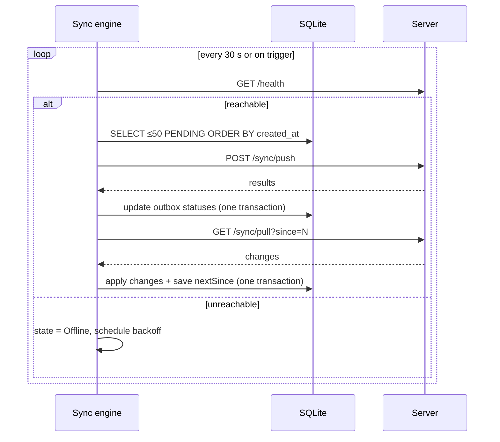

# 06 — Offline Mode and Synchronization Design

**Product:** Cedar POS · **Version:** 1.0 (planning) · **Date:** 2026-11-08

---

## 1. The idea in one page

Think of each device as a **shop assistant with a notebook**:

1. Every morning (and every few seconds while connected) the assistant **copies the price list and stock sheet** from head office → **PULL**.
2. During the day they **write every sale in the notebook**, whether or not head office answers the phone → **local SQLite**.
3. Each written page is also put in an **envelope with a unique number** in the **outbox**.
4. Whenever the line works, envelopes are posted to head office → **PUSH**. Head office keeps a list of envelope numbers already received. If the same envelope arrives twice (because the confirmation got lost), it's recognised and ignored → **idempotency**.
5. Head office never "overwrites" a sale; it **adds** it. Stock is the sum of all sales, returns and deliveries — so two assistants selling the last item at the same time is not a conflict, just a stock of −1 that someone checks → **append-only + ledger**.

That's the whole design. The rest of this document is the precise version.

---

## 2. What is synced, in which direction

| Data | Direction | Created where | Conflict possible? | Policy |
|---|---|---|---|---|
| Products, variants, barcodes, prices, categories, taxes, units | Server → devices | Server (online back office) | No (single writer) | Server wins; devices replace their copy |
| Users, roles, permissions, settings, rate | Server → devices | Server | No | Server wins |
| Customers | Both | Server; **quick-create at POS offline** | Rare (same new phone on two tills) | Merge by phone: second create becomes a link to the first; `sync_issue` INFO |
| Stock levels | Server → devices | Server (computed) | No | Server wins; device shows "as of" time + local unsynced deltas |
| Sales, returns, payments | Device → server (+ 30-day branch history down) | Device | **No** (unique UUID, append-only) | Always accepted; anomalies flagged |
| Cash sessions & movements | Device → server | Device | No (one register = one device) | Always accepted |
| Customer payments | Device → server | Device | No | Accepted; ledger updated |
| Stock adjustments | Device → server | Desktop / mobile | No | Accepted; if above threshold → PENDING_APPROVAL |
| Goods receipt (scan) | Mobile → server | Phone | Two people receive the same order | Quantities **add**; received > ordered → FLAGGED `OVER_RECEIPT`; average cost updated per receipt |
| Stock count lines | Mobile/desktop → server | Device | Two people count the same item | Lines are **added** (both counts kept); approver sees "counted twice" and chooses (sum for different locations, or one) |
| Approval requests | Device ↔ server | Device (mobile channel needs online) | No | — |
| Master-data edits | Online only | Back office | Edit/edit | Optimistic lock → 409 → user reloads |

---

## 3. Device states



| State | What the user sees | What works |
|---|---|---|
| Online | Green pill "Online · synced 12 s ago" | Everything |
| Offline | Amber pill "Offline · 7 waiting" | Selling, returns from local history, cash, counts, adjustments; back office read-only |
| Restricted | Red banner "Connect to continue — offline for 3 days" | Close session & view only; no new sales (protects against an abandoned/stolen till) |
| Deactivated | Full-screen message | Nothing; local unsynced data is kept for export by an Owner |

---

## 4. Push protocol

### 4.1 Request
`POST /api/v1/sync/push`
```json
{
  "deviceId": "6f1c…",
  "deviceTime": "2026-11-08T12:41:07.120Z",
  "schemaVersion": 1,
  "pendingCount": 42,
  "operations": [
    {
      "opId": "0193f3a2-…",          // outbox id = idempotency key
      "type": "SALE",
      "entityId": "0193f3a2-9c…",     // sale id
      "createdAt": "2026-11-08T12:40:55.003Z",
      "payload": { "sale": { … }, "lines": [ … ], "payments": [ … ] }
    }
  ]
}
```
- Batch size ≤ 50 operations, sent **in creation order**.
- One operation = one **aggregate** (e.g. a whole sale with lines and payments) so the server never sees half a sale.

### 4.2 Server processing (per operation, each in its own DB transaction)



### 4.3 Response
```json
{
  "serverTime": "2026-11-08T12:41:07.480Z",
  "results": [
    { "opId": "0193f3a2-…", "status": "APPLIED" },
    { "opId": "0193f3a3-…", "status": "DUPLICATE" },
    { "opId": "0193f3a4-…", "status": "FLAGGED", "issue": "OVER_RETURN" },
    { "opId": "0193f3a5-…", "status": "REJECTED", "error": "UNKNOWN_VARIANT" }
  ]
}
```
Device: APPLIED / DUPLICATE / FLAGGED → mark `DONE`. RETRY_LATER → keep `PENDING`. REJECTED → `FAILED`, visible in the Sync Center with the reason (the data stays on the device; it is never silently deleted).

### 4.4 Ordering and dependencies
Device always pushes in `created_at` order, so `CASH_SESSION_OPEN` is sent before the sales inside it, and a sale before its return. If something arrives out of order anyway (e.g. after a FAILED item is fixed), the server answers RETRY_LATER for dependents.

---

## 5. Pull protocol

`GET /api/v1/sync/pull?since=18342&limit=500`

```json
{
  "changes": [
    { "seq": 18343, "type": "PRODUCT_VARIANT", "op": "UPSERT", "data": { … } },
    { "seq": 18344, "type": "PRICE",           "op": "UPSERT", "data": { … } },
    { "seq": 18345, "type": "STOCK_LEVEL",     "op": "UPSERT", "data": { "variantId": "…", "qty": 12, "asOf": "…" } },
    { "seq": 18346, "type": "BARCODE",         "op": "DELETE", "id": "…" }
  ],
  "nextSince": 18346,
  "hasMore": false
}
```
- The server filters the change feed by the device's **business and branch** (and for mobile, by the user's branches).
- `data` is the **current full state** of the record (not a diff), so applying a change twice is harmless.
- The device saves `nextSince` only after applying the page in one local transaction.
- **Bootstrap** (new device) = `since=0` pages until `hasMore=false`. For speed, the server can answer `since=0` from a snapshot instead of replaying the log.
- **Rate** and **settings** are part of the same feed (`EXCHANGE_RATE`, `SETTINGS`, `USER`, `ROLE`).

### 5.1 Showing correct stock on a device
`displayed stock = last pulled stock_level − quantities in this device's local, not-yet-acknowledged sales + returns`
So a terminal never "forgets" what it sold itself while offline.

---

## 6. Sync engine (client side)

| Setting | Desktop | Mobile |
|---|---|---|
| Push trigger | After each completed transaction (debounced 2 s) + every 30 s | After each count/adjustment + every 60 s in foreground |
| Pull trigger | Every 30 s + after push | On app open, pull-to-refresh, every 60 s in foreground |
| Health check | `GET /api/v1/health` (2 s timeout) | Same + OS connectivity events |
| Backoff on failure | 5 s, 10 s, 20 s, 40 s … max 5 min | Same |
| Thread | Background `ScheduledExecutorService`; never blocks the UI | Dart isolate-free async; Workmanager for background (Could) |
| Concurrency | One sync cycle at a time (lock) | Same |



---

## 7. Duplicate-transaction prevention — all layers

| Layer | Protection |
|---|---|
| UI | "Complete sale" button disabled after first click until the local commit finishes |
| Local DB | Sale, outbox row and invoice-number increment in **one** SQLite transaction — no sale without an outbox row, no number used twice |
| Network | Same `opId` is re-sent on retry (never a new one) |
| Server | `processed_operations` PK on `opId`; `sales.id` PK; `UNIQUE (business_id, invoice_no)` |
| Online API calls (non-sync) | `Idempotency-Key` header on POSTs that create money records (e.g. supplier payment from back office) |

---

## 8. Offline document numbering

| Document | Format | Counter location |
|---|---|---|
| Sale | `B01-T02-000123` | `local_sequences` on the terminal |
| Return | `R-B01-T02-000017` | terminal |
| Z-report / session | `Z-B01-T02-0042` | terminal (server verifies continuity) |
| Adjustment (mobile) | `ADJ-B01-M01-00008` | phone |
| Purchases, transfers, counts | `PO-B01-00045`, `TR-…`, `SC-…` | server (created online) |

If a terminal is reinstalled, it receives its last used numbers from the server during bootstrap, so numbers continue rather than restart.

---

## 9. Edge cases and how they are handled

| # | Situation | Handling |
|---|---|---|
| E1 | Two offline tills sell the last unit | Both sales applied; stock = −1; negative-stock report + optional notification |
| E2 | Same receipt returned at two tills while offline | Each till checks its local copy; server applies both, `qty_returned` exceeds sold → FLAGGED `OVER_RETURN` → manager reviews (money already left) |
| E3 | Price changed while till offline | Till sells at the old price (that's what the customer saw on the shelf); sale stores the price used |
| E4 | Product deactivated while till offline | Sale accepted; FLAGGED `INACTIVE_PRODUCT` (INFO) |
| E5 | Exchange rate changed while till offline | Sale uses the till's rate (stored on the sale); stale-rate warning after 24 h |
| E6 | Terminal clock wrong by 3 hours | Server compares `deviceTime` with `serverTime`; skew stored; sale keeps device time but reports use `recorded_at` when skew > 5 min; FLAGGED `CLOCK_SKEW` |
| E7 | App crashes between commit and print | Sale exists locally; on restart, "Last sale not printed — reprint?" |
| E8 | Server crashes mid-push | Transaction rolled back; device retries same opIds; already-committed ops answer DUPLICATE |
| E9 | Push succeeded but response lost | Device retries; server returns stored result (DUPLICATE) |
| E10 | Session opened offline on T01, user also logs in on T02 | Sessions belong to a register, not a user; T02 has its own register/session |
| E11 | Customer quick-created offline on two tills with the same phone | Second becomes a link to the first (merge); sales re-pointed; INFO issue |
| E12 | Manager deletes a user who has offline sales | Users are deactivated, never deleted; sales still reference them |
| E13 | Device deactivated while it has unsynced sales | Server still accepts pushes from a revoked device **only** for already-created operations (created_at before revocation) and flags them; then blocks |
| E14 | Server update changes payload format | `schemaVersion` — server accepts current and previous version |
| E15 | Very long offline period (1 week, 3,000 sales) | Push in batches of 50; progress bar in Sync Center; restricted mode after 72 h stops *new* sales only |
| E17 | Rate changed on phone while a terminal is offline | Terminal keeps old rate until it reconnects (sales store the rate used); after reconnect it pulls the new rate and shows the cashier a notice |
| E18 | Goods received offline on the phone while the purchase was cancelled online | Receipt accepted (goods physically arrived) and FLAGGED for the manager |
| E16 | Count in progress while sales continue | Each count line stores `counted_at`; at approval, correction = counted − (expected at counted_at) using movements, so sales during counting are not double-counted |

---

## 10. Sync Center (UI requirement)

Both apps have a **Sync Center** screen showing: connection state, last successful push and pull, number of pending items (by type), failed items with reason and "Retry"/"Export", clock skew warning, rate age, and a "Sync now" button. Owners/Managers see a server-side list of **sync issues** for all devices with "Resolve" + note.

---

## 11. Security of offline data

- Local DB contains only the device's branch data; cost prices omitted on devices whose users lack `catalog.view_cost`.
- PINs cached as bcrypt hashes; refresh token stored encrypted (Windows DPAPI on desktop, secure storage on mobile).
- Offline operation time-limited (72 h).
- Optional SQLCipher encryption on desktop (Could).
