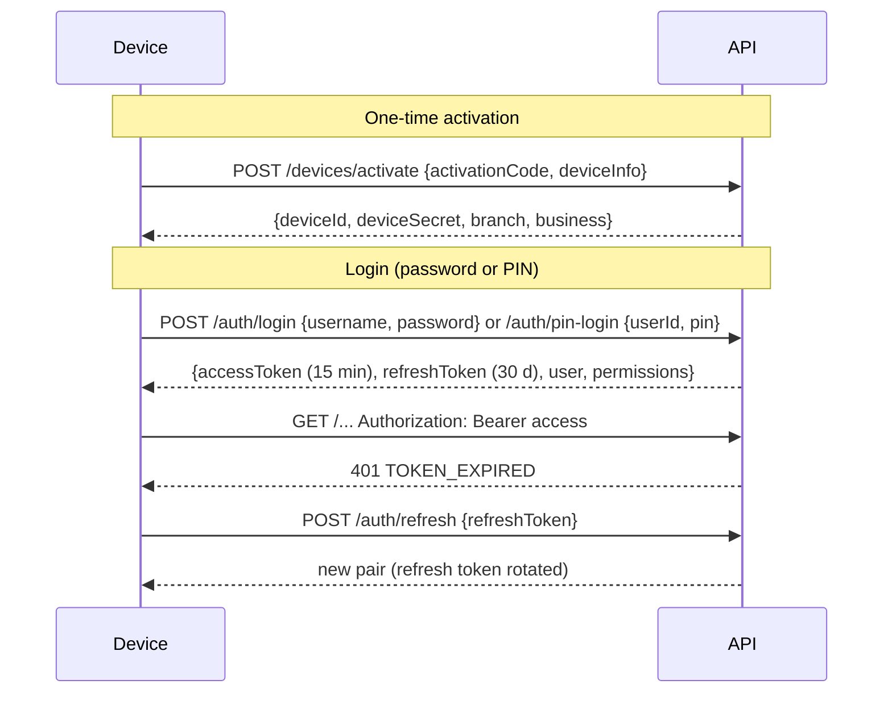

# 07 — API Architecture and Endpoint Plan

**Product:** Cedar POS · **Version:** 1.0 (planning) · **Date:** 2026-11-08
**Base URL:** `https://<server>/api/v1` · **Docs:** Swagger UI at `/swagger-ui` (springdoc-openapi)

---

## 1. Conventions

| Topic | Convention |
|---|---|
| Style | REST, JSON, plural nouns (`/products`), actions as sub-resources (`/purchases/{id}/receive`) |
| Versioning | URL prefix `/api/v1`; breaking changes → `/api/v2` |
| Auth | `Authorization: Bearer <JWT>` on all endpoints except `/auth/*`, `/devices/activate`, `/health` |
| Device | `X-Device-Id` header on every call from an activated device |
| Tenant | Business id **only** from the token — never accepted from body/query |
| IDs | UUID strings |
| Money | Decimal **strings** (`"12.5000"`) with explicit `currency` — never JSON floats |
| Time | ISO-8601 UTC (`2026-11-08T12:41:07.120Z`) |
| Pagination | `?page=0&size=50&sort=name,asc` → `{ items, page, size, totalItems, totalPages }` |
| Filtering | Query params (`?branchId=&from=&to=&q=`) |
| Concurrency | Responses include `version`; updates send `If-Match: <version>` → `409 Conflict` if stale |
| Idempotency | `Idempotency-Key` header required on online POSTs that create money records; sync uses `opId` |
| Errors | RFC 7807 `application/problem+json` |
| Rate limits | `/auth/*`: 10 req/min per IP+username |

### 1.1 Error format
```json
{
  "type": "https://cedarpos.local/errors/validation",
  "title": "Validation failed",
  "status": 422,
  "code": "VALIDATION_FAILED",
  "detail": "2 fields are invalid",
  "errors": [ { "field": "lines[0].quantity", "message": "must be > 0" } ],
  "requestId": "c1a7…"
}
```

| HTTP | `code` examples |
|---|---|
| 400 | `MALFORMED_REQUEST` |
| 401 | `TOKEN_EXPIRED`, `INVALID_CREDENTIALS`, `DEVICE_REVOKED` |
| 403 | `PERMISSION_DENIED` (+ `permission` field), `BRANCH_NOT_ALLOWED` |
| 404 | `NOT_FOUND` |
| 409 | `VERSION_CONFLICT`, `DUPLICATE_BARCODE`, `SESSION_ALREADY_OPEN` |
| 422 | `VALIDATION_FAILED`, `BUSINESS_RULE` (+ `rule`: e.g. `BR-RET-01`) |
| 423 | `ACCOUNT_LOCKED` |
| 429 | `RATE_LIMITED` |

---

## 2. Authentication flow



JWT claims: `sub` (user id), `bid` (business), `brs` (allowed branch ids or `*`), `rid` (role), `pv` (permissions version), `did` (device), `exp`.

---

## 3. Endpoint plan

P = priority (M/S/C) · 🔄 = also delivered through the sync feed · Perm = required permission

### 3.1 System & auth

| Method | Path | Purpose | Perm | P |
|---|---|---|---|---|
| GET | `/health` | Liveness + server time | public | M |
| POST | `/devices/activate` | Activate a device with one-time code | public (code) | M |
| POST | `/auth/login` | Username + password | public | M |
| POST | `/auth/pin-login` | PIN login on an activated desktop | device | M |
| POST | `/auth/refresh` | Rotate tokens | refresh token | M |
| POST | `/auth/logout` | Revoke refresh token | auth | M |
| GET | `/me` | Current user, role, permissions, branches | auth | M |
| POST | `/me/change-password` · `/me/change-pin` | Credentials | auth | M |
| POST | `/me/push-token` | Register FCM token | auth | S |

### 3.2 Organization, users, settings

| Method | Path | Purpose | Perm | P |
|---|---|---|---|---|
| GET/PUT | `/business` | Business profile & policies | settings.manage | M |
| GET/POST | `/branches` · GET/PUT `/branches/{id}` | Branches 🔄 | branches.manage | M |
| GET/POST | `/devices` · PUT `/devices/{id}` | List / create (returns activation code) / rename | devices.manage | M |
| POST | `/devices/{id}/deactivate` · `/regenerate-code` | Revoke / new code | devices.manage | M |
| GET/POST | `/cash-registers` · PUT `/{id}` | Registers | devices.manage | M |
| GET/POST | `/users` · GET/PUT `/users/{id}` | Users 🔄 | users.manage | M |
| POST | `/users/{id}/reset-password` · `/reset-pin` · `/unlock` | Admin actions | users.manage | M |
| GET/POST | `/roles` · PUT/DELETE `/roles/{id}` | Roles 🔄 | roles.manage | M/S |
| GET | `/permissions` | Permission catalogue | roles.manage | M |
| GET/PUT | `/settings/receipt` · `/settings/pos` | Grouped settings 🔄 | settings.manage | M |
| GET | `/exchange-rates/current` · `/exchange-rates?from=&to=` | Current & history 🔄 | catalog.view | M |
| POST | `/exchange-rates` | Set new USD→LBP rate | exchange_rate.set | M |
| GET/POST | `/tax-rates` · PUT `/{id}` | Taxes 🔄 | settings.manage | M |

### 3.3 Catalog

| Method | Path | Purpose | Perm | P |
|---|---|---|---|---|
| GET/POST | `/categories` · PUT/DELETE `/{id}` | Category tree 🔄 | catalog.edit | M |
| GET/POST | `/units` | Units 🔄 | catalog.edit | M |
| GET | `/products?q=&categoryId=&active=&page=` | Search products | catalog.view | M |
| POST | `/products` | Create product (+ default variant, barcode, price) | catalog.edit | M |
| GET/PUT | `/products/{id}` | Detail incl. variants, packagings, barcodes, prices / update | catalog.edit | M |
| POST | `/products/{id}/deactivate` | Soft delete | catalog.edit | M |
| GET/POST | `/attributes` · POST `/attributes/{id}/values` | Variant attributes | catalog.edit | S |
| POST | `/products/{id}/variants/generate` | Build variant matrix from attribute values | catalog.edit | S |
| POST/PUT/DELETE | `/products/{id}/variants[/{vid}]` | Manage variants 🔄 | catalog.edit | S |
| POST/DELETE | `/variants/{id}/packagings[/{pid}]` | Packagings 🔄 | catalog.edit | M |
| POST/DELETE | `/variants/{id}/barcodes[/{bid}]` | Barcodes 🔄 (409 if duplicate) | catalog.edit | M |
| POST | `/barcodes/generate` | Next internal barcode | catalog.edit | M |
| GET | `/barcodes/{code}` | Lookup variant by barcode (mobile scan) | catalog.view | M |
| GET | `/variants/{id}/prices` · POST `/variants/{id}/prices` | Price history / set new price (closes previous) 🔄 | catalog.price_edit | M |
| POST | `/products/import` (multipart CSV/XLSX) · GET `/products/import/{jobId}` | Bulk import + result report | catalog.import | S |
| POST | `/labels/pdf` | Render labels for variants → PDF | catalog.labels | C |

### 3.4 Inventory

| Method | Path | Purpose | Perm | P |
|---|---|---|---|---|
| GET | `/stock?branchId=&q=&lowOnly=` | Stock levels (+ value if permitted) 🔄 | inventory.view | M |
| GET | `/stock/{variantId}/branches` | Stock of one item in every branch (mobile lookup) | inventory.view | M |
| GET | `/stock/movements?branchId=&variantId=&type=&from=&to=` | Movement history | inventory.view | M |
| PUT | `/stock/{branchId}/{variantId}/reorder` | Reorder point & qty | inventory.reorder_edit | M |
| GET | `/stock-adjustments` · GET `/{id}` | List / detail | inventory.view | M |
| POST | `/stock-adjustments/{id}/approve` · `/reject` | Approval of large adjustments | inventory.adjust_approve | M |
| GET/POST | `/stock-counts` · GET `/{id}` | Counts (create online) | inventory.count | M |
| GET | `/stock-counts/{id}/variance` | Expected vs counted, value impact | inventory.count_approve | M |
| POST | `/stock-counts/{id}/approve` · `/cancel` | Post corrections | inventory.count_approve | M |
| GET/POST | `/transfers` · GET/PUT `/{id}` | Transfers | inventory.transfer | S |
| POST | `/transfers/{id}/send` · `/receive` · `/cancel` | Status changes (receive with quantities) | inventory.transfer | S |

*(Stock adjustments and count lines are **created** through sync so they work offline.)*

### 3.5 Purchasing

| Method | Path | Purpose | Perm | P |
|---|---|---|---|---|
| GET/POST | `/suppliers` · GET/PUT `/{id}` | Suppliers | suppliers.manage | M |
| GET | `/suppliers/{id}/statement?from=&to=` | Purchases, payments, balance | purchases.view | S |
| GET/POST | `/purchases` · GET/PUT `/{id}` | Purchases (draft editable); `?status=ORDERED,PARTIAL` for the mobile receive list 🔄 | purchases.create | M |
| POST | `/purchases/{id}/order` · `/receive` · `/cancel` | Status changes; receive body = quantities per line | purchases.receive | M |
| POST | `/supplier-payments` | Pay supplier (Idempotency-Key) | suppliers.pay | S |
| GET | `/purchase-recommendations?branchId=&supplierId=&coverDays=` | Suggested order quantities | purchases.view | S |
| POST | `/purchase-recommendations/to-purchase` | Create draft purchase from selected suggestions | purchases.create | S |

### 3.6 Sales, returns, customers (online reads; writes via sync)

| Method | Path | Purpose | Perm | P |
|---|---|---|---|---|
| GET | `/sales?branchId=&deviceId=&cashierId=&from=&to=&q=` | Invoice list | reports.sales | M |
| GET | `/sales/{id}` · `/sales/by-number/{invoiceNo}` | Invoice detail (returns lookup across tills) | pos.sell | M |
| GET | `/sales/{id}/receipt.pdf` | Receipt as PDF | pos.reprint | S |
| GET | `/returns` · `/returns/{id}` | Returns list / detail | reports.sales | M |
| GET/POST | `/customers` · GET/PUT `/{id}` | Customers 🔄 | customers.manage | M |
| GET | `/customers/{id}/statement` | Ledger, balance | customers.view | S |
| PUT | `/customers/{id}/credit` | Credit enabled + limit | customers.credit_limit | S |

### 3.7 Cash & expenses

| Method | Path | Purpose | Perm | P |
|---|---|---|---|---|
| GET | `/cash-sessions?branchId=&status=&from=&to=` | Sessions with differences | cash.sessions_view | M |
| GET | `/cash-sessions/{id}` · `/{id}/z-report` | Detail / Z data (JSON, PDF) | cash.sessions_view | M |
| GET/POST | `/expense-categories` | Categories | expenses.create | M |
| GET/POST | `/expenses` · GET/PUT `/{id}` | Expenses (online back office; from-drawer pay-outs via sync) | expenses.create | M |

### 3.8 Approvals & notifications

| Method | Path | Purpose | Perm | P |
|---|---|---|---|---|
| POST | `/approvals` | Terminal requests mobile approval | pos.sell | S |
| GET | `/approvals?status=PENDING` | Manager inbox | approvals.decide | S |
| GET | `/approvals/{id}` | Status (terminal polls every 2 s) | auth | S |
| POST | `/approvals/{id}/approve` · `/reject` | Decision (+ note) | approvals.decide | S |
| GET | `/notifications?unread=true` · POST `/notifications/{id}/read` · `/read-all` | In-app notifications | auth | S |
| GET | `/alerts?status=OPEN&branchId=` · GET `/alerts/{id}` (evidence) · POST `/alerts/{id}/review` | Suspicious-activity alerts | reports.employees | S |
| GET/PUT | `/settings/alert-rules` | Thresholds (doc 09 §8) | settings.manage | S |

### 3.9 Dashboard & reports

All report endpoints accept `branchId` (or all permitted), `from`, `to` (Beirut-time day boundaries), and `format=json|csv|pdf` (CSV/PDF = Should).

| Method | Path | Returns | Perm | P |
|---|---|---|---|---|
| GET | `/dashboard/summary` | Sales, count, avg basket, gross profit, vs. yesterday, payment mix, low-stock count | dashboard.view | M |
| GET | `/dashboard/live?since=<ts>` | Latest synced sales (feed) + terminal status | live_sales.view | M |
| GET | `/dashboard/branches` | Per branch: today's sales, open sessions, devices online/offline, pending sync | dashboard.view | M |
| GET | `/reports/sales-summary?groupBy=day|hour|branch|cashier|category|product` | Sales aggregates | reports.sales | M |
| GET | `/reports/top-products` | Top N by revenue / quantity / profit | reports.sales | M |
| GET | `/reports/profit` | Revenue, COGS, returns, gross margin | reports.financial | M |
| GET | `/reports/profit-and-loss` | + expenses → net | reports.financial | M |
| GET | `/reports/vat` | VAT collected by rate | reports.financial | S |
| GET | `/reports/inventory-valuation` | Qty × avg cost by branch/category | reports.inventory | M |
| GET | `/reports/stock-movements-summary` | In/out by type | reports.inventory | S |
| GET | `/reports/cash-sessions` | Differences by cashier | cash.sessions_view | M |
| GET | `/reports/employees` | Sales, voids, discounts, refunds per user | reports.employees | S |
| GET | `/reports/customer-balances` · `/supplier-balances` | Receivables / payables | reports.financial | S |
| GET | `/reports/daily-summary?date=&branchId=` | Closing summary (also sent as notification) | reports.financial | S |
| GET | `/exchange-rates/current/delivery` | Which terminals have pulled the current rate | exchange_rate.set | M |

### 3.10 Sync

| Method | Path | Purpose | P |
|---|---|---|---|
| POST | `/sync/push` | Upload outbox batch (document 06 §4) | M |
| GET | `/sync/pull?since=&limit=` | Change feed (document 06 §5) | M |
| GET | `/sync/bootstrap/status` | Size estimate for first sync | S |
| GET | `/sync/issues?status=OPEN` · POST `/sync/issues/{id}/resolve` | Sync issues for managers | M |
| GET | `/sync/devices` | Per-device sync state (powers branch monitoring) | M |

### 3.11 Audit

| Method | Path | Purpose | Perm | P |
|---|---|---|---|---|
| GET | `/audit-logs?userId=&action=&entityType=&from=&to=` | Audit trail | audit.view | M |
| GET | `/audit-logs/verify` | Verify hash chain | audit.view | C |

**Total:** ~120 endpoints, of which ~70 are Must.

---

## 4. Sync operation payload types

| `type` | Payload | Server effect |
|---|---|---|
| `CASH_SESSION_OPEN` | session header + floats | Insert session (checks one open per register) |
| `SALE` | sale + lines + payments | Insert; SALE movements; costs; customer ledger if credit; change_log |
| `SALE_VOID` | sale id, reason, approval | Status VOIDED; reverse movements and session cash |
| `RETURN` | return + lines + refunds | Insert; RETURN movements (restock lines); `qty_returned`; ledger |
| `CASH_MOVEMENT` | pay-in/out/no-sale | Insert; expense if linked |
| `CUSTOMER_CREATE` | quick-created customer | Insert or merge by phone |
| `CUSTOMER_PAYMENT` | payment | Insert; ledger |
| `STOCK_ADJUSTMENT` | header + lines | POSTED (movements) or PENDING_APPROVAL |
| `STOCK_COUNT_LINES` | count id + lines | Insert lines (append) |
| `STOCK_COUNT_SUBMIT` | count id | Status SUBMITTED |
| `APPROVAL_PIN` | locally approved action record | Insert approval (channel PIN) |
| `CASH_SESSION_CLOSE` | counts, expected, differences, Z no | Close; notify if difference > threshold; evaluate suspicious-activity rules; daily summary if last session of the day |
| `PURCHASE_RECEIPT` | purchase id, lines (variant, qty), supplier invoice no | `qty_received` += qty; PURCHASE movements; avg cost; status PARTIAL/RECEIVED; over-receipt flagged |

---

## 5. Example: product detail response

```json
{
  "id": "0193…",
  "name": "Polo Shirt",
  "categoryId": "…",
  "taxRate": { "id": "…", "name": "VAT 11%", "ratePercent": "11.00" },
  "baseUnit": { "id": "…", "name": "Piece", "allowsDecimal": false },
  "hasVariants": true,
  "trackStock": true,
  "version": 4,
  "variants": [
    {
      "id": "…",
      "sku": "POLO-M-NVY",
      "variantName": "M / Navy",
      "attributes": [ { "name": "Size", "value": "M" }, { "name": "Colour", "value": "Navy" } ],
      "barcodes": [ { "code": "6291041500213", "type": "EAN13", "packagingId": null } ],
      "packagings": [],
      "price": { "currency": "USD", "amount": "18.0000", "effectiveFrom": "2026-11-01T00:00:00Z" },
      "stock": [ { "branchId": "…", "branchCode": "B01", "qty": "7.000" } ]
    }
  ]
}
```

---

## 6. Implementation notes

- **Controller → Service → Repository**; controllers contain no business logic.
- DTOs are Java `record`s with Bean Validation annotations; mapping with MapStruct (or manual).
- A shared `pos-core` module defines the **sync payload DTOs**, so desktop and server compile against the same classes.
- OpenAPI spec exported to `docs/api/openapi.json` during the build; the Flutter API client models are written against it (code generation = Could).
- Every endpoint has at least one integration test for: success, permission denied, other-tenant access (404), validation error.
