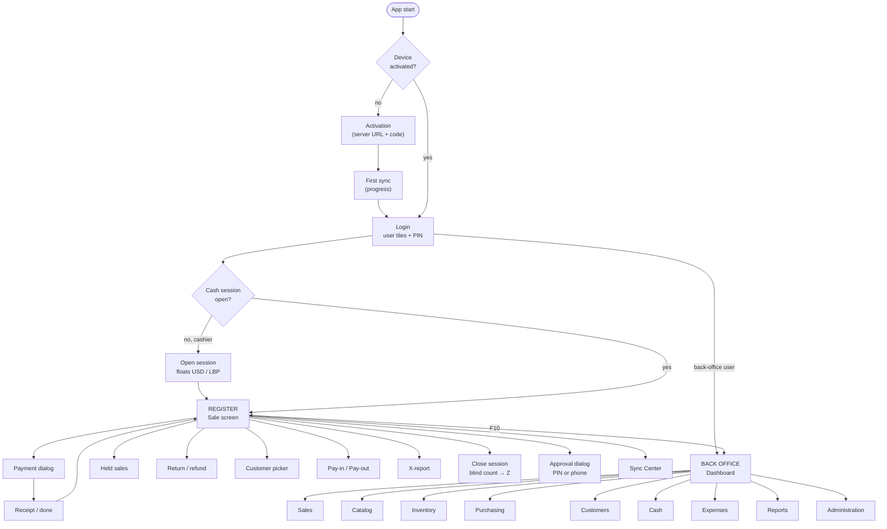
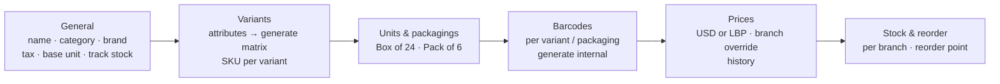

# 08 — Desktop Application: Screen Structure and Navigation

**Product:** Cedar POS Desktop (JavaFX) · **Version:** 1.0 (planning) · **Date:** 2026-11-08
Visual design rules: document 13 (Ledger design system).

---

## 1. Two modes, one application

| Mode | Who | Layout | Optimised for |
|---|---|---|---|
| **Register mode** | Cashiers (and managers at the till) | Full-screen, no sidebar, large type, keyboard-first | Speed, few errors, 8-hour shifts |
| **Back office mode** | Managers, owners, stock keepers, accountants | Sidebar + top bar + content, dense tables | Managing data, reports |

Users with both permissions switch with **F10** ("Back office" / "Register"). Cashiers only ever see Register mode.

---

## 2. Navigation map



---

## 3. Application shell

### 3.1 Register mode layout (1366×768 and up)

```
┌────────────────────────────────────────────────────────────────────────────────────┐
│ CEDAR · B01 Hamra · T02      Rana K. (Cashier)   ● Online · 12s   1 USD = 89,500 LBP│  top bar 48px
├───────────────────────────────────────────────┬────────────────────────────────────┤
│ [ Scan or search product…            ] [F2]   │  RECEIPT RAIL                      │
│                                               │  Customer: Walk-in        [F3]     │
│  ┌ Category chips ───────────────────────┐    │  ─────────────────────────────     │
│  │ Drinks  Snacks  Dairy  Bakery  …      │    │  2 × Water 1.5L        $1.00       │
│  └───────────────────────────────────────┘    │  1 × Labneh 500g       $3.75       │
│  ┌───────┐┌───────┐┌───────┐┌───────┐         │  1 × Polo M / Navy    $18.00       │
│  │ item  ││ item  ││ item  ││ item  │  quick  │     − 10% disc         −$1.80      │
│  │ tile  ││ tile  ││ tile  ││ tile  │  grid   │  · · · · · · · · · · · · · · ·     │
│  └───────┘└───────┘└───────┘└───────┘         │  Items 4     VAT incl.   $2.08     │
│  ┌───────┐┌───────┐┌───────┐┌───────┐         │                                    │
│  │       ││       ││       ││       │         │  TOTAL            $20.95           │
│  └───────┘└───────┘└───────┘└───────┘         │                1,875,000 LBP       │
│                                               │  [ F12  PAY ]                      │
├───────────────────────────────────────────────┴────────────────────────────────────┤
│ F3 Customer  F4 Discount  F5 Hold  F6 Recall  F7 Qty  F8 Return  F9 Cash  Del Void │  key bar 40px
└────────────────────────────────────────────────────────────────────────────────────┘
```

### 3.2 Back office layout

```
┌──────────┬─────────────────────────────────────────────────────────────────────────┐
│ CEDAR    │  Products                                [ + New product ]  ● Online     │
│          │  ─────────────────────────────────────────────────────────────────────── │
│ Dashboard│  [Search…]  Category ▾  Status ▾  Branch ▾                    Export ▾   │
│ Sales    │  ┌──────────────────────────────────────────────────────────────────┐   │
│ Catalog ▸│  │ SKU      Name              Category   Price     Stock B01   ⋯     │   │
│ Inventory│  │ ──────────────────────────────────────────────────────────────── │   │
│ Purchase │  │ …                                                                │   │
│ Customers│  └──────────────────────────────────────────────────────────────────┘   │
│ Cash     │                                              ‹ 1 2 3 … 12 ›   50/page    │
│ Expenses │                                                                          │
│ Reports  │                                                                          │
│ Admin   ▸│                                                                          │
│──────────│                                                                          │
│ Register │                                                                          │
│ Sync ●   │                                                                          │
└──────────┴─────────────────────────────────────────────────────────────────────────┘
  sidebar 232px (collapsible to 64px)
```

**When offline**, back-office edit buttons are disabled with a tooltip "Needs connection — changes to products and settings are made online"; lists show cached data with an "As of 10:42" label.

---

## 4. Register mode screens

| # | Screen | Purpose | Key elements | Perm | Offline |
|---|---|---|---|---|---|
| R1 | **Activation** | Bind terminal to branch | Server URL, 8-char code, test connection, first-sync progress | — | ❌ |
| R2 | **Login** | Fast user switch | Tiles of branch users (photo/initials), PIN pad (keyboard or touch), "Use password" link | — | ✅ |
| R3 | **Open session** | Start shift | Register name, opening float USD & LBP (denomination helper), previous Z summary | cash.open | ✅ |
| R4 | **Sale** | Build the basket | Search/scan field (always focused), category chips, quick grid, receipt rail, totals USD/LBP, stock warning badges | pos.sell | ✅ |
| R5 | **Product search** (F2) | Find by name/SKU | Instant results, stock, price, variant picker for products with variants | pos.sell | ✅ |
| R6 | **Variant picker** | Choose size/colour | Matrix grid (rows = size, columns = colour) with stock per cell | pos.sell | ✅ |
| R7 | **Line editor** | Qty / discount / price | Quantity, line discount (% / $), price override (🔑), note | pos.* | ✅ |
| R8 | **Payment** (F12) | Take money | See §5 | pos.sell | ✅ |
| R9 | **Sale complete** | Confirm | Change to give (per currency, big), receipt printing status, "New sale" (Enter) | — | ✅ |
| R10 | **Customer picker** (F3) | Attach customer | Search by phone/name, balance & credit limit, quick-create | customers.view | ✅ |
| R11 | **Held sales** (F5/F6) | Park / recall | List with time, items, total, note | pos.hold | ✅ |
| R12 | **Return** (F8) | Refund | Scan receipt / search invoice no → original lines with returnable qty → choose qty & restock → refund method & currency → print return receipt | returns.* | ✅ (local 30-day history) |
| R13 | **Approval dialog** | Exceptions | Reason, what is requested, "Manager PIN" (offline OK) or "Ask on phone" (online; waiting state with countdown) | — | ◐ |
| R14 | **Cash in/out** (F9) | Pay-in / pay-out / no sale | Type, currency, amount, reason (required) | cash.pay_in_out | ✅ |
| R15 | **X-report** | Mid-shift check | Sales, payments by method & currency, expected cash (if permitted); print | cash.x_report | ✅ |
| R16 | **Close session** | End shift | Step 1 blind count USD & LBP (denominations) → Step 2 expected vs counted, differences highlighted → Step 3 Z-report print | cash.close | ✅ |
| R17 | **Reprint / recent sales** | Last 50 sales | Search, reprint (COPY), void (🔑, same session) | pos.reprint | ✅ |
| R20 | **New rate notice** | When a new USD→LBP rate arrives: non-blocking banner "New rate: 1 USD = 90,000 LBP (set by Hadi, 14:52)"; applied to the next sale, never to the basket being paid | — | ✅ (on reconnect) |
| R18 | **Sync Center** | Health | Online state, pending by type, failed items, rate age, "Sync now" | — | ✅ |
| R19 | **Lock screen** | Idle lock | Same as login, keeps current basket | — | ✅ |

---

## 5. The payment dialog (most important screen)

```
┌──────────────────────────────── PAYMENT ───────────────────────────────────┐
│  TOTAL DUE                         $20.95   ·   1,875,000 LBP               │
│  ────────────────────────────────────────────────────────────────────────  │
│  Tenders                                                                   │
│   Cash USD     [  20.00 ]   quick: $5 $10 $20 $50 $100  Exact              │
│   Cash LBP     [ 100,000 ]  quick: 100k 500k 1M  Exact                     │
│   Card         [        ]   currency ▾  ref [      ]                       │
│   On account   [        ]   (customer required · limit $200 · owes $35)    │
│  ────────────────────────────────────────────────────────────────────────  │
│  Paid      $21.12   (= $20.00 + 100,000 LBP @ 89,500)                      │
│  REMAINING  —                                                              │
│  CHANGE     $0.17   →  Give:  ( ) USD 0.17   (•) LBP 15,000   ( ) Mixed    │
│                                                                            │
│  [ Esc  Back ]                                   [ Enter  COMPLETE SALE ]  │
└────────────────────────────────────────────────────────────────────────────┘
```

Rules shown on this screen: BR-MON-03 … BR-MON-08. Change suggestion: whole dollars in USD, remainder in LBP rounded to the LBP step; the cashier can switch. "Complete" is enabled only when remaining ≤ tolerance. The dialog is fully keyboard-driven: Tab between tenders, number keys, Enter to complete.

---

## 6. Keyboard map (register)

| Key | Action | Key | Action |
|---|---|---|---|
| (scan) / Enter | Add item | F8 | Return |
| F2 | Product search | F9 | Cash in/out |
| F3 | Customer | F10 | Switch to back office |
| F4 | Discount (line / invoice) | F11 | X-report |
| F5 | Hold sale | F12 | Pay |
| F6 | Recall held | Del | Void selected line |
| F7 / `*` | Quantity (`3*` then scan = 3 units) | + / − | Qty +1 / −1 |
| ↑ ↓ | Select line | Ctrl+P | Reprint last |
| Esc | Back / cancel dialog | Ctrl+L | Lock |

**Scanner detection:** USB scanners type like a keyboard. Characters arriving < 30 ms apart and ending with Enter are treated as a scan, wherever the focus is, so a scan never ends up in the wrong field.

---

## 7. Back-office screens

| Area | Screens | Main actions | Perm |
|---|---|---|---|
| **Dashboard** | Today / 7 days / 30 days; branch filter; KPI tiles; sales by hour; top products; payment mix (USD cash / LBP cash / card / credit); low stock; open sessions; sync issues badge | Drill into report | dashboard.view |
| **Sales** | Invoices list → Invoice detail (lines, payments, returns, audit) · Returns list → detail | Filter, reprint PDF, export | reports.sales |
| **Catalog** | Products list · **Product editor** (tabs: General · Variants · Units & packagings · Barcodes · Prices · Stock & reorder) · Categories (tree, drag-sort, colour) · Attributes · Units · Tax rates · Import wizard (upload → map columns → preview errors → import) · Labels (C) | Create, edit, deactivate, generate variants/barcodes, set prices | catalog.* |
| **Inventory** | Stock levels (branch, low-only, value) · Movements (ledger) · Adjustments (list, new, approve) · Stock counts (list, new, variance review, approve) · Transfers (list, new, send, receive) · Reorder settings | Adjust, count, transfer | inventory.* |
| **Purchasing** | Suppliers (list, detail, statement) · Purchases (list, editor, receive) · Supplier payments · Recommendations (select → draft purchase) | Order, receive, pay | purchases.*, suppliers.* |
| **Customers** | List · Detail (info, credit, statement, history) · Receive payment | Edit, credit limit | customers.* |
| **Cash** | Sessions (list with differences, detail, Z PDF) · Cash movements · Registers | Review | cash.sessions_view |
| **Expenses** | List · New/edit · Categories | Record | expenses.* |
| **Reports** | Sales summary · Top products · Profit · P&L · VAT · Inventory valuation · Cash sessions · Employees · Customer / supplier balances | Filter, chart, export CSV/PDF | reports.* |
| **Administration** | Business & policies · Branches · Devices (activation codes) · Cash registers · Users · Roles & permissions (checkbox matrix) · Exchange rate (current + history + set) · Receipt designer (header/footer, preview) · Hardware (printer select, test print, drawer test, scanner test) · Audit log · Sync issues | Configure | admin perms |

### 7.1 Product editor — structure


Simple products hide the Variants tab (one default variant behind the scenes).

---

## 8. Hardware integration (desktop)

| Device | Approach | Fallback |
|---|---|---|
| Receipt printer (80 mm ESC/POS) | `escpos-coffee`, USB (Windows printer name) or network (IP:9100); receipt template: header, items, totals USD + LBP, VAT line, payments & change per currency, invoice no + barcode (Code-128) for returns, footer | On-screen receipt + "Save PDF" |
| Cash drawer | ESC/POS "kick" command through the printer (pin 2), sent when a cash tender/refund/pay-out happens or "no sale" | Message "Open drawer manually" |
| Barcode scanner | Keyboard wedge + timing detection (§6) | Manual typing |
| Customer display | — (Could: second window on extended monitor) | — |

Settings → Hardware has **Test print**, **Test drawer** and **Scanner test** buttons — useful for demos and for support.

---

## 9. JavaFX implementation structure

| Concern | Approach |
|---|---|
| Views | FXML per screen + controller; reusable components (`MoneyLabel`, `CurrencyField`, `PinPad`, `DataTableView`, `StatusPill`, `EmptyState`) |
| State | ViewModel per screen with JavaFX properties; services injected via a tiny `AppContext` |
| Navigation | `Navigator` service: `goTo(Screen.SALE)`, dialog stack, back history in back office |
| Threading | DB and network on a background executor; UI updates via `Platform.runLater`; never block the FX thread |
| Styling | AtlantaFX base + `ledger.css` (tokens from document 13) |
| Errors | Inline field errors; toast for background events; blocking dialog only for destructive confirmations |
