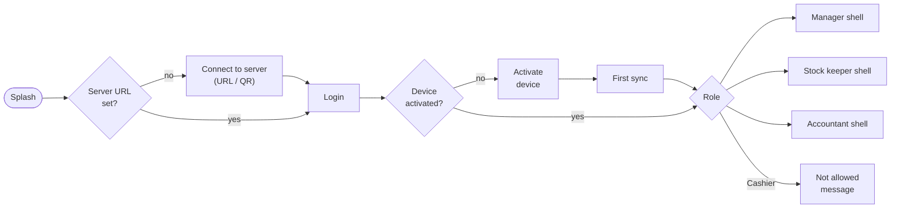
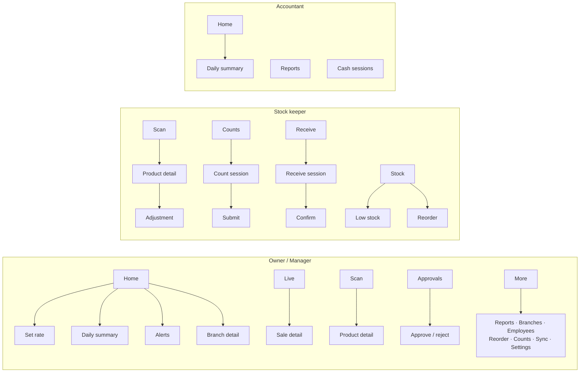

# 09 — Mobile Application: Screen Structure and Navigation

**Product:** Cedar POS Mobile (Flutter) · **Version:** 1.0 (planning) · **Date:** 2026-11-08
Visual design rules: document 13.

---

## 1. Purpose

The mobile app is a **management and stock tool**, not a small copy of the till:

- **Owners / managers** — "How is the business doing right now, and what needs my decision?"
- **Stock keepers** — "Scan, count, receive, correct, and know what to reorder."

**Design rule:** the phone does what a fixed till **cannot** — it goes where the person is: the owner away from the store, the stock keeper at the stockroom door or in an aisle. Every main feature below follows that rule:

| Feature | Why it must be on the phone |
|---|---|
| Set the exchange rate | The rate moves during the day; the owner is rarely at the till |
| Approve discounts / voids / refunds | The manager is on the floor or away; the cashier and customer are waiting |
| Daily closing summary | The owner wants the day's result without opening anything |
| Suspicious-activity alerts | Theft signals must reach the owner, not the person being watched |
| Receive goods by scanning | Deliveries arrive at the back door, not at the till |
| Count stock offline | Stockrooms often have no Wi-Fi |
| Shelf check (price, stock in all branches) | The question is asked in the aisle |

---

## 2. Role-based navigation

Bottom navigation changes with the role (from `/me` permissions):

| Tab | Owner / Manager | Stock Keeper | Accountant |
|---|---|---|---|
| 1 | **Home** (dashboard) | **Scan** (lookup) | **Home** |
| 2 | **Live** (sales feed) | **Counts** | **Reports** |
| 3 | **Scan** (lookup) | **Stock** (levels, low stock) | **Live** |
| 4 | **Approvals** (badge) | **Receive** (deliveries) | **Cash** (sessions) |
| 5 | **More** | **More** | **More** |





Routing: `go_router` with a **redirect guard**: each route declares its required permission; unauthorised routes redirect to Home with a snackbar.

---

## 3. Screen inventory

| # | Screen | Content & actions | Perm | Offline |
|---|---|---|---|---|
| M1 | **Connect** | Server URL (manual or scan QR shown on desktop Admin › Devices), test connection | — | ❌ |
| M2 | **Login** | Username, password, "remember me" (refresh token), biometric unlock after first login (Could) | — | ❌ first / ✅ unlock |
| M3 | **Activate device** | 8-char code from manager | — | ❌ |
| M4 | **Home (dashboard)** | **Rate card at the top** ("1 USD = 89,500 LBP · set 3 h ago" → tap to change); branch selector (All / B01 / B02); KPI cards: Sales today (USD + LBP), Transactions, Avg basket, Gross profit (if permitted), vs yesterday %; Sales-by-hour chart; Payment mix; Top 5 products; Alerts strip (low stock, approvals, sync issues, cash differences) | dashboard.view | Snapshot + "as of" |
| M5 | **Branch detail** | Today's sales, open sessions (cashier, opened at, sales count), terminals (online / offline / last sync / pending items), sync issues | dashboard.view | Snapshot |
| M6 | **Live sales** | Reverse-chronological feed: time, branch·terminal, cashier, items, total USD/LBP, payment icons, flags (discount, return, void). Auto-refresh 15 s; pause/resume; filter by branch | live_sales.view | Last loaded |
| M7 | **Sale detail** | Lines, discounts, payments & change per currency, approvals, linked returns | reports.sales | Cached if viewed |
| M8 | **Scan / lookup** | Camera scanner (torch, beep, haptic), manual search fallback | catalog.view | ✅ |
| M9 | **Product detail** | Name, variants, barcode(s), price (USD / LBP), cost & margin (if permitted), stock per branch, last movements, reorder point; actions: Adjust · Add to count · Edit reorder | catalog.view | ✅ (local stock "as of") |
| M10 | **Counts list** | Open / submitted / approved counts for my branches; "Start count" (online — creates count on server) | inventory.count | ✅ list |
| M11 | **Count session** | Big scan area; after scan: item name + **qty keypad** (+1 quick-tap mode for repeated scans); running list; search to add without barcode; works offline; progress "126 items counted" | inventory.count | ✅ |
| M12 | **Count review & submit** | Counted items, not-yet-counted items in scope, duplicates warning; Submit (queues if offline) | inventory.count | ✅ (queued) |
| M13 | **Variance review** (manager) | Expected vs counted, value impact, sort by biggest loss; Approve / send back | inventory.count_approve | ❌ |
| M14 | **New adjustment** | Reason (damaged/expired/lost/found/internal use/other), items with ± qty, note, optional photo (C); above threshold → "needs approval" | inventory.adjust | ✅ |
| M15 | **Stock / low stock** | List with filters (branch, category, below reorder point, negative) | inventory.view | ✅ |
| M16 | **Reorder (purchase recommendations)** — opened from Stock / More | Grouped by supplier; per item: on hand, avg daily sales, days of cover, suggested qty (editable); "Create draft purchase" (online) | purchases.view | Last loaded |
| M17 | **Approvals inbox** | Pending requests with countdown: type, terminal, cashier, what & how much; history tab | approvals.decide | ❌ |
| M18 | **Approval detail** | Full context (e.g. basket for discount), Approve / Reject + note; result sent in < 2 s to the terminal | approvals.decide | ❌ |
| M19 | **Employees** | Per cashier (period): sales, transactions, avg basket, discounts given, voids, refunds, cash differences; tap → detail | reports.employees | Snapshot |
| M20 | **Reports** | Sales summary · Profit · P&L · Inventory valuation · Cash sessions · VAT — date-range picker, branch filter, chart + table, share as PDF/CSV (S) | reports.* | Cached last |
| M21 | **Cash sessions** | Sessions with differences per currency, Z details | cash.sessions_view | Snapshot |
| M22 | **Notifications** | List; tap opens related screen (approval, product, session) | — | ✅ cached |
| M23 | **Sync Center** | Online state, pending outbox items, failed items, last pull, "Sync now" | — | ✅ |
| M24 | **Settings / profile** | Change password, notification preferences, server info, app version, log out | — | ◐ |
| M25 | **Set exchange rate** | Current rate, last changes (who/when), new-rate field with LBP preview of a sample $10 / $100, confirm → server; shows "Delivered to 4 of 4 terminals" as they pull it | exchange_rate.set | ❌ |
| M26 | **Receive list** | Purchases ORDERED / PARTIAL for my branches: supplier, expected date, lines, progress | purchases.receive | ✅ (cached) |
| M27 | **Receive session** | Continuous scan; each scan adds 1 unit (or 1 box for a box barcode) with +/− and quantity keypad; shows ordered vs received; unknown barcode → "not on this order" with option to add a note; supplier invoice no.; works offline | purchases.receive | ✅ |
| M28 | **Confirm receipt** | Summary: complete / short / over lines; over-receive warning; Confirm → outbox (`PURCHASE_RECEIPT`) | purchases.receive | ✅ (queued) |
| M29 | **Daily summary** | Today (or chosen day): sales USD/LBP, transactions, gross profit, returns, cash differences per terminal & currency, top products, vs same weekday last week; share as image/PDF | reports.financial | Snapshot |
| M30 | **Alerts (suspicious activity)** | List by severity: cashier, session, rule triggered (e.g. "7 voids — threshold 3"), time; tap → evidence (the sales, audit entries); mark reviewed + note | reports.employees | Snapshot |

---

## 4. Push notifications

| Event | Recipients | Tap opens |
|---|---|---|
| Approval requested | Managers of that branch (+ Owner) | M18 |
| Item reached reorder point (batched every 30 min) | Stock keepers + managers | M15 filtered |
| Cash difference > threshold at close | Managers + Owner | M21 detail |
| Sync issue (ERROR) / terminal offline > 1 h with pending sales | Managers + Owner | M5 |
| Count submitted | Managers | M13 |
| **Daily closing summary** | Owner (+ Accountant) | M29 |
| **Suspicious activity** (rule triggered) | Owner, managers of that branch (never the cashier concerned) | M30 |
| Goods received with differences | Managers | Purchase detail |

Delivered via **Firebase Cloud Messaging**; the same items are stored in `notifications`, so they are visible in-app even if push is disabled or Firebase is not configured (demo fallback).

---

## 5. Offline behaviour on mobile

| Feature | Behaviour |
|---|---|
| Product lookup & scan | Local Drift DB (branch catalog + stock levels) |
| Counting, adjustments, **receiving goods** | Saved locally → outbox → pushed when online (document 06) |
| Dashboard / reports / live | Show last snapshot with a clear "Offline · data from 10:42" banner |
| Approvals, variance approval, reorder → purchase, set rate | Disabled with explanation (they must reach the server immediately to be useful) |

---

## 6. Purchase recommendation formula (FR-PUR-06)

Plain language: *"How many days will my current stock last, and how much should I order so it lasts until the next delivery plus a safety margin?"*

For each variant in a branch:

| Symbol | Meaning | Source |
|---|---|---|
| `D` | Average daily sales (units) over the last 28 days | `stock_movements` type SALE − RETURN |
| `L` | Supplier lead time (days) | `suppliers.lead_time_days` (default 3) |
| `C` | Cover days wanted after delivery (default 14, adjustable) | Request parameter |
| `S` | Safety stock = `D × 3` (3 days, configurable) | — |
| `H` | On hand | `stock_levels` |
| `O` | Already on order | Σ ordered − received on ORDERED/PARTIAL purchases |
| `R` | Reorder point (if set) | `stock_levels.reorder_point` |

```
needs_reorder  = (H + O) ≤ max(R, D × L + S)
suggested_qty  = ceil_to_pack( D × (L + C) + S − H − O )      // if > 0
days_of_cover  = H / D                                        // "∞" if D = 0
```
`ceil_to_pack` rounds up to the supplier packaging (e.g. multiples of 24). Items with no sales in 28 days and stock > 0 are listed separately as **slow movers** (don't reorder). The supplier for an item = supplier of its most recent purchase.

---

## 7. Flutter implementation structure

| Concern | Approach |
|---|---|
| Architecture | Feature-first: `features/<feature>/{data, domain, presentation}`; shared `core/` |
| State | Riverpod (`AsyncNotifier` per screen) |
| Local DB | Drift with DAOs; streams so the UI updates when sync writes |
| Network | Dio + interceptors: auth header, refresh on 401, device id, retry on timeout |
| Sync | `SyncService` (outbox push, pull since) shared by features |
| Money | `decimal` package; formatting helpers `formatUsd`, `formatLbp`; never `double` |
| Theme | `ThemeData` built from Ledger tokens (document 13), light + dark |
| Scanner | `mobile_scanner` with a custom overlay; continuous mode for counting |
| Charts | `fl_chart` styled with tokens |
| Testing | Unit (money, formula, sync), widget (key screens), integration test (count offline → submit) |

---

## 8. Suspicious-activity rules (FR-MOB-18)

Evaluated by the server when sessions and sales are synced. Thresholds are business settings (defaults shown).

| Rule | Trigger (per cashier, per session unless stated) | Default |
|---|---|---|
| Many voids | Voided lines + voided sales | > 3 |
| Drawer opened without sale | `NO_SALE` cash movements | > 2 |
| High discounting | Discount total / sales total | > 8% |
| Returns without receipt | Count in a day (per branch) | > 2 |
| Cash difference | |difference| at close (either currency, USD equivalent) | > $5 |
| Refund soon after sale | Return of a sale made by the same cashier < 10 min earlier | any |

Each alert stores the rule, values and links; it never blocks work — it informs the owner.
