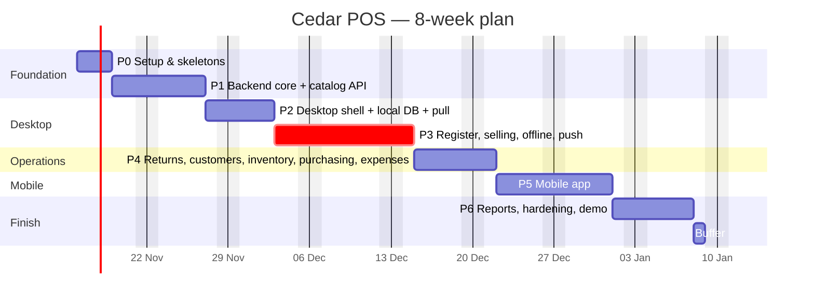
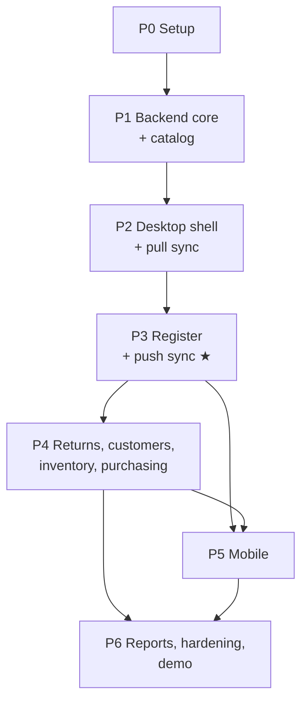

# 12 — Development Roadmap

**Product:** Cedar POS · **Version:** 1.0 (planning) · **Date:** 2026-11-08
**Capacity:** 1 developer · 8 weeks = 40 working days (39 planned + 1 buffer) · start assumed **Mon 16 Nov 2026** after document approval. If you take days off over Christmas / New Year, the end date moves by the same number of days.

---

## 1. Strategy in plain words

- **Build the spine first.** A sale must flow end-to-end (desktop → offline → server → phone) by **week 4**. Everything else hangs on it.
- **One phase at a time, with your approval** before each next phase (as the brief requires).
- **Must first, Should next, Could only with spare time.** A clear **cut line** (§5) says what is dropped first if the schedule slips.
- **Each phase ends with a demo** you can run yourself, and with `PROJECT_STATUS.md` updated with evidence.

> **Honest assessment:** 8 weeks for three applications plus offline sync is tight for one person, even with AI help. The plan works if the Must items stay Must and the cut line is respected. If week 4's milestone slips by more than 3 days, we cut Should items immediately rather than hoping to catch up.

---

## 2. Timeline

| Week | Phase | Milestone at end of week |
|---|---|---|
| 1 | P0 + start P1 | Repo, builds, DB migrated, login via Swagger |
| 2 | P1 | Catalog, users, branches, devices, rate — all via API with tests |
| 3 | P2 → P3 | Desktop activates, logs in by PIN, downloads catalog, shows products |
| 4 | P3 | ★ **Spine milestone:** mixed-currency sale offline → syncs → visible in DB/Swagger; receipt prints |
| 5 | P3 → P4 | Cash sessions & Z; returns; customers & credit |
| 6 | P4 → P5 | Inventory (adjust, count), purchasing, expenses; mobile shell + rate from phone |
| 7 | P5 → P6 | Mobile: dashboard, live, scan, offline count, receiving, approvals, daily summary, alerts |
| 8 | P6 + buffer | Reports, audit, chaos tests, demo data, final docs & presentation |

---

## 3. Phases, dependencies and acceptance criteria

### P0 — Setup & skeletons (3 days) · depends on: approved documents
**Accomplishes:** a working, empty system you can build and run with one command per app.
- Monorepo per document 10; Maven parent with `pos-core`, `pos-server`, `pos-desktop`; Flutter project
- PostgreSQL database + Flyway `V1` baseline (all 57 tables), `V2` permissions/roles seed, `V3` currencies/units
- Spring Boot `/health`, Swagger, JSON logging; JavaFX window with Ledger CSS; Flutter app with Ledger theme
- GitHub Actions CI (S)
- Tracking files created: `PROJECT_STATUS.md`, `ROADMAP.md`, `DECISIONS.md`, `CHANGELOG.md`

**Acceptance criteria**
- [ ] `mvn verify` passes; `flutter test` passes
- [ ] Flyway creates the schema on an empty DB; pgAdmin shows 57 tables with FKs
- [ ] `/health` returns server time; desktop and mobile start and show a Ledger-styled placeholder

### P1 — Backend core & catalog API (6 days) · depends on: P0
**Accomplishes:** the server knows businesses, branches, users, devices, rates and products, and protects them.
- `pos-core`: Money, rounding, tax, SaleCalculator, document numbers + full unit tests (§3 of doc 11)
- Identity: login, PIN login, refresh, logout, lockout, permissions, `TenantContext`
- Organization: business, branches, devices + activation codes, registers, settings
- Currency: rate set/history/current
- Catalog: categories, units, taxes, products, default variant, packagings, barcodes (uniqueness, generate), prices (history, branch override, USD/LBP); variants matrix (S)
- Change log writer; `GET /sync/pull`
- Audit writer for login, price, rate, user/role changes

**Acceptance criteria**
- [ ] All `pos-core` money tests green (T-MON, T-TAX, T-PRC, T-NUM)
- [ ] Through Swagger: create branch, device, users of each role, set rate, create a product with 2 barcodes and an LBP price
- [ ] Tenant-isolation and permission tests (T-SEC-01…03) green
- [ ] `/sync/pull?since=0` returns all created entities in order

### P2 — Desktop shell, local DB, pull sync (4 days) · depends on: P1
**Accomplishes:** a terminal that is registered, logs in fast, and has the catalog locally.
- Activation screen, first sync with progress, SQLite migrations, local repositories
- Login screen (user tiles + PIN), offline PIN login with 72 h limit
- Pull sync engine (periodic), status pill, Sync Center (pull part)
- Back-office shell (sidebar, top bar) + Products list (read) + Exchange rate screen
- Components: MoneyLabel, CurrencyField, PinPad, StatusPill, KeyCap

**Acceptance criteria**
- [ ] New terminal activated with a code → downloads 500 demo products in < 30 s
- [ ] PIN login works with the server stopped
- [ ] Price changed on server → visible on terminal within 30 s

### P3 — Register: selling, payments, offline, push (8 days) · depends on: P2 · ★ critical
**Accomplishes:** the heart of the product — real sales that never get lost.
- Open session (USD + LBP floats); sale screen (scan, search, quick grid, qty, line/invoice discount with limit)
- Variant picker (S); stock warnings; hold/recall (S)
- Payment dialog: split tenders, dual currency, change suggestion, LBP rounding
- Atomic local commit + outbox; invoice numbering; receipt printing (ESC/POS + PDF fallback); drawer kick; scanner filter
- Server: `POST /sync/push`, idempotency, sale ingest with stock movements + avg cost + change_log; `sync_issues`
- Manager PIN approval dialog; approval record
- Cash: pay-in/out, X-report, **close session with blind count**, Z-report; cash difference notification
- Reprint; void in same session (S)

**Acceptance criteria**
- [ ] Mixed-currency sale matches the worked example in SRS §5.1 to the last LBP
- [ ] T-SAL-01/02/03, T-STK-01, T-SYN-01/02/03 green
- [ ] With the server stopped: 20 sales, then restart → all 20 on server exactly once; stock correct
- [ ] Close session: expected USD and LBP match a hand calculation; Z-report printed
- [ ] Keyboard-only 5-item cash sale < 20 s

### P4 — Returns, customers, inventory, purchasing, expenses (5 days) · depends on: P3
**Accomplishes:** the store can run a full week: refunds, stock work, deliveries, costs.
- Returns against receipt (local + server lookup), restock flag, refund currency, over-return flag; without receipt (S)
- Customers: CRUD, quick-create at POS, credit accounts + payments + statement (S)
- Inventory: stock levels, movements, adjustments (+approval), counts (create, desktop counting, variance, approve), reorder points *(transfers between branches moved to Could — decision D-024)*
- Purchasing: suppliers, purchase (draft → ordered → received, partial), avg cost update, supplier payments (S)
- Expenses (incl. paid from drawer → pay-out)
- Back-office screens for all of the above

**Acceptance criteria**
- [ ] T-RET-01, T-CNT-01, T-PUR-01, T-AVG-01/02 green
- [ ] Receive purchase of 24 @ $2 into stock of 10 @ $1.50 → avg $1.8529 shown
- [ ] Return refunded in LBP reduces expected LBP cash in the session
- [ ] Credit sale over limit requires approval; statement balance correct

### P5 — Mobile app (8 days) · depends on: P3 (API), P4 (counts, purchases, reorder)
**Accomplishes:** the owner and stock staff can run the business from a phone — doing what a fixed till cannot.
- Connect, login, activation, role-based shell & guards
- **Set exchange rate from the phone** + delivery status; terminal "new rate" notice (M)
- Home dashboard (rate card on top), branch detail, live sales feed (15 s)
- **Receive goods by scanning**, offline, `PURCHASE_RECEIPT` sync op (S)
- **Daily closing summary** + **suspicious-activity rules & alerts** (server jobs + screens) (S)
- Scan/lookup (camera), product detail with stock per branch
- Offline counting (Drift outbox) and adjustments; Sync Center
- Approvals inbox + detail; terminal "Ask on phone" flow (S)
- Reorder recommendations (S); employees (S); reports (sales, profit, cash)
- Notifications list + FCM push (S)

**Acceptance criteria**
- [ ] Sale on desktop appears in Live within 30 s (online)
- [ ] Count 30 items in airplane mode → submit after reconnect → visible on desktop variance screen (T-SYN-09)
- [ ] Cashier account cannot log in to mobile; stock keeper sees no financial data
- [ ] Discount approval round-trip phone ↔ terminal < 5 s
- [ ] Rate set on phone → all online terminals show it within 30 s (T-SYN-13)
- [ ] Delivery of 3 lines received offline on the phone → stock and average cost correct after sync (T-SYN-12)
- [ ] Session with 5 voids triggers one alert to the owner; daily summary equals the profit report (T-ALR-01/02)

### P6 — Reports, hardening, demo (5 days) · depends on: P4, P5
**Accomplishes:** trustworthy numbers, a confident demo, and handover documents.
- Reports: sales summary, top products, profit, P&L, inventory valuation, cash sessions, VAT (S), employees (S), CSV/PDF export (S)
- Desktop dashboard; audit log viewer; sync issues screen
- Chaos tests T-SYN-04…11; stock reconciliation job; backup scripts + **tested restore**
- Demo data `R__demo_data.sql`, barcode sheet, jpackage installer, README
- Final review of docs; presentation

**Acceptance criteria**
- [ ] Profit report = Σ(line revenue − cost) recomputed in SQL by hand for one day
- [ ] Full demo script (doc 11 §7) runs without intervention
- [ ] Restore of the DB to a point in time demonstrated
- [ ] All Must requirements in the SRS marked ✅ with test evidence in PROJECT_STATUS.md

---

## 4. Dependency graph

---

## 5. Cut line (what goes first if late)

Dropped in this order — the system stays complete and integrated after each cut:

1. Label printing, CSV/PDF export, hash-chain audit (C)
2. Push notifications via FCM (S) — the in-app notification list remains (daily summary & alerts still visible in the app)
3. Suspicious-activity rules beyond the first three (voids, no-sale, cash difference)
4. Variant matrix generator UI (S) — variants entered one by one
5. Purchase recommendations (S) — low-stock list remains
6. Customer credit accounts (S) — customers & history remain
7. Mobile "Ask on phone" approvals (S) — manager PIN remains
8. Employees screen, VAT report (S)

**Never cut:** offline selling, idempotent sync, dual-currency payments & cash, returns, stock ledger, counts, roles/permissions, audit log, mobile dashboard/live/scan/offline count, **rate from phone**.

Already moved out of the plan: transfers between branches (now Could).

---

## 6. Risks to the schedule

| Risk | Likelihood | Impact | Response |
|---|---|---|---|
| Offline sync takes longer than planned | Medium | High | Built in P3 with the simplest protocol; chaos tests early; cut line |
| Printer/drawer driver problems | Medium | Medium | PDF/on-screen fallback from day one; test hardware in week 4 |
| JavaFX UI polish takes time | Medium | Medium | Components first (P2), screens reuse them |
| No Mac for iOS build | High | Low | Demo on Android; iOS is "builds in CI" (Could) |
| Testcontainers/Docker unavailable | Medium | Low | Dedicated test DB on local PostgreSQL |
| Only 1 buffer day after the mobile upgrade | Medium | Medium | Cut line applied strictly from week 5; FCM push is the first cut |
| Scope creep from new ideas | High | High | New ideas → DECISIONS.md as "future"; only after approval |

---

## 7. After the internship (future roadmap)

Transfers between branches · Mobile POS · AI business assistant (natural-language questions over reports) · loyalty & gift cards · promotions engine · batch/expiry & serial/IMEI tracking · scale integration · customer display · e-commerce sync · Arabic UI (RTL) · integrated card payments · cloud deployment & subscriptions.
