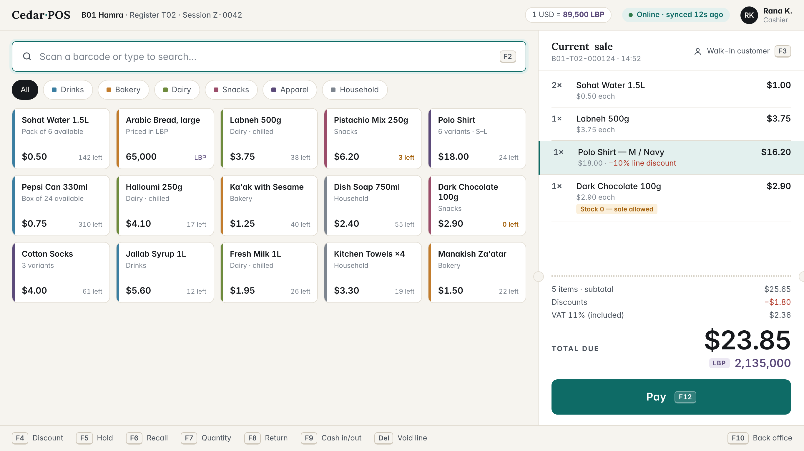
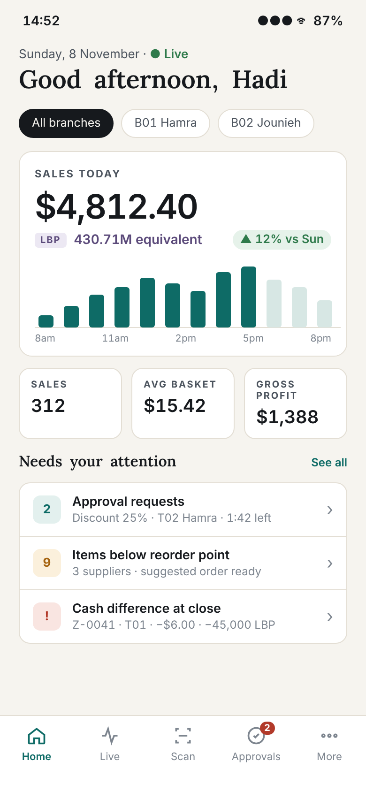

# 13 — UI/UX Design System: "Ledger"

**Product:** Cedar POS (desktop + mobile) · **Version:** 1.0 (planning) · **Date:** 2026-11-08

---

## 1. Design concept

**Ledger** borrows from the things retail trust is built on: **paper receipts, account books and banknotes**. It's calm and precise, and money is always the most legible thing on the screen.

| Principle | In practice |
|---|---|
| **The total is sacred** | The amount due is always the biggest element on the register, in tabular figures, with LBP directly beneath |
| **Colour means something** | Neutral paper and ink everywhere. Colour is reserved for: teal = primary action / healthy state, amber = attention, red = destructive / loss, plum = LBP |
| **Paper, not glass** | Warm off-white surfaces, hairline rules, almost no shadows (dialogs only). No gradients, no glassmorphism |
| **Keyboard first, touch friendly** | Every action has a key (shown as a key-cap chip); targets ≥ 44 px |
| **Calm under pressure** | Offline and errors are shown clearly but never alarmingly; only destructive actions ask for confirmation |
| **Same language on both apps** | Shared tokens, names and icons, so a manager moving between desktop and phone feels at home |

### Signature elements (what makes it recognisable)
1. **Receipt rail.** The basket on the register is a white "paper" column with a dotted perforation line and punched notches before the totals.
2. **Dual-currency stack.** USD is primary in ink. LBP sits below in plum with a small `LBP` tag. The two currencies never look alike.
3. **Ledger tables.** Only horizontal hairline rules, right-aligned tabular numbers, and no zebra stripes or vertical lines.
4. **Serif headings.** Page titles, report headings and section titles are set in **Lora**, which gives an editorial, account-book tone. Everything functional is in **Inter**.
5. **Key-cap chips.** Shortcuts are shown as small physical keys (`F12`), which teaches the keyboard workflow passively.
6. **Category spines.** Product tiles carry a 4 px coloured spine for their category, so colour stays meaningful but quiet.

---

## 2. Mockups

### 2.1 Desktop — register (sale screen)

What to notice: the always-focused search/scan field; the receipt rail with the selected line highlighted; the LBP-priced bread tile; the low-stock (amber) and zero-stock warnings that don't block the sale; and the total in USD and LBP with the rounding already applied (`$23.85 × 89,500 = 2,134,575 → 2,135,000`).

### 2.2 Mobile — manager home

What to notice: the branch filter chips; the dual-currency hero figure; the sales-by-hour chart with future hours greyed; the KPI row; the "Needs your attention" list with typed severity colours; and the approvals badge in the tab bar.

*(Mockups are HTML sources in `mockups/` and can be edited and re-rendered.)*

---

## 3. Design tokens

### 3.1 Colour — light theme (default)

| Token | Hex | Use |
|---|---|---|
| `paper` | `#F6F4EF` | App background |
| `surface` | `#FFFFFF` | Cards, receipt rail, tables, inputs |
| `sunken` | `#EFECE5` | Wells, disabled fields, table header |
| `ink` | `#16191D` | Primary text, totals |
| `ink-2` | `#4C545E` | Secondary text, labels |
| `ink-3` | `#7D858F` | Hints, placeholders (not for essential info) |
| `rule` | `#E3DED4` | Hairlines, borders |
| `rule-strong` | `#CFC8BB` | Input borders, perforation |
| `accent` | `#0E6B66` | Primary buttons, focus, active nav, "online" |
| `accent-soft` | `#E3F0EE` | Selected row, focus halo, info badges |
| `positive` | `#2F7A4B` | Increases, money in, success |
| `warning` / `-soft` | `#A5630F` / `#FBF0DC` | Low stock, offline, pending |
| `danger` / `-soft` | `#B23A2A` / `#F9E5E1` | Void, refund, loss, errors |
| `lbp` / `-soft` | `#5B4A7A` / `#ECE8F3` | Lebanese pound amounts and tags |

### 3.2 Colour — dark theme

| Token | Hex | | Token | Hex |
|---|---|---|---|---|
| `paper` | `#111315` | | `accent` | `#4DB6A9` |
| `surface` | `#1A1D20` | | `accent-soft` | `#173431` |
| `sunken` | `#0C0E10` | | `positive` | `#5DBB7E` |
| `ink` | `#ECE8E0` | | `warning` | `#E0A044` |
| `ink-2` | `#A9AFB6` | | `danger` | `#E5735F` |
| `rule` | `#2A2E33` | | `lbp` | `#B9A6DA` |

All text/background pairs meet **WCAG AA** (≥ 4.5:1 for body text). `ink-3` is used only for non-essential hints.

### 3.3 Typography

| Role | Font | Size / line-height / weight | Where |
|---|---|---|---|
| Display total | Inter, tabular figures | 44 / 48 / 600, tracking −1 | Register total, payment dialog |
| KPI | Inter, tabular | 32–36 / 40 / 600 | Dashboard hero |
| Page title | **Lora** | 24–28 / 32 / 600 | Back office, mobile headers |
| Section title | **Lora** | 16–18 / 24 / 600 | Cards, report sections |
| Body | Inter | 14 / 20 / 400 | Default |
| Body strong | Inter | 14 / 20 / 600 | Line items, values |
| Label caps | Inter | 11–12 / 16 / 700, tracking 1.4 | "TOTAL DUE", KPI labels |
| Caption | Inter | 12 / 16 / 400 | Hints, timestamps |

**Numbers:** always tabular (equal-width digits) so columns line up. Flutter: `FontFeature.tabularFigures()`. JavaFX can't switch font features, so amounts use **JetBrains Mono Medium** there, or Inter's tabular-figure variant if it is bundled. All fonts are open-licensed (OFL) and bundled with the apps.

**Formatting:** USD `$1,234.50`. LBP `1,875,000` with an `LBP` tag (no decimals). Large LBP on dashboards may be abbreviated: `430.71M`. Negative values: `−$1.80` (true minus sign) in `danger`.

### 3.4 Spacing, shape, elevation

| Token | Value |
|---|---|
| Spacing scale | 4 · 8 · 12 · 16 · 20 · 24 · 32 · 48 |
| Radius | 6 (inputs, buttons-small) · 8 (search, buttons) · 10 (tiles, cards) · 14 (mobile cards) · 999 (pills, chips) |
| Borders | 1 px `rule`; inputs 1 px `rule-strong`; focus 1.5 px `accent` + 4 px `accent-soft` halo |
| Elevation | None for cards (borders instead); dialogs `0 12 32 rgba(22,25,29,.18)` |
| Motion | 120–180 ms ease-out; no bounce; respect "reduce motion" |
| Density | Register: rows 48 px, tiles 104 px · Back office: rows 40 px · Mobile: list rows 56–64 px |

### 3.5 Iconography
A single outline icon set at **1.75–2 px stroke** (Lucide or Tabler, both open source; Ikonli provides them in JavaFX). Icons always come with a text label in navigation.

---

## 4. Components

| Component | Variants / states | Notes |
|---|---|---|
| **Button** | Primary (accent), Secondary (surface + rule), Ghost, Danger; sm/md/lg (register lg = 60 px) | Key-cap chip inside when a shortcut exists |
| **Key-cap chip** | default, on-dark | `F12` |
| **Money label** | USD primary, LBP secondary, negative, strike (voided) | One component used everywhere so formatting is never re-implemented |
| **Currency field** | USD (2 dp), LBP (0 dp, thousands separators while typing) | Quick-amount buttons attached |
| **Status pill** | Online, Syncing, Offline (n waiting), Restricted | Dot + text, never colour alone |
| **Product tile** | default, low stock, out of stock, LBP-priced, has variants | Category spine |
| **Receipt line** | default, selected, discounted, warning badge, returned | |
| **Data table** | sortable, selectable, loading skeleton, empty state | Ledger rules, sticky header |
| **KPI card** | value, delta (▲ ▼), sparkline | |
| **Alert row** | info / warning / danger with count badge | |
| **PIN pad** | 3×4 grid, 64 px keys, masked dots, error shake (reduced-motion safe) | |
| **Dialog** | standard, destructive confirm, approval (waiting countdown) | Esc = cancel, Enter = primary |
| **Toast** | info, success, warning | Bottom-right desktop, bottom mobile; 4 s |
| **Empty state** | Icon + one sentence + primary action | "No held sales. Press F5 to park the current sale." |
| **Scanner overlay** (mobile) | scanning, found, not found, torch | Haptic + beep on success |

---

## 5. Content and tone

- Plain, short and specific. Use "Stock 0 — sale allowed", not "Warning: inventory constraint violation".
- Errors say **what happened and what to do next**: "Can't reach the server. Sales are saved on this register and will sync automatically."
- Use verbs on buttons: "Complete sale", "Approve discount", "Close session".
- Show times relative for freshness ("synced 12 s ago") and absolute in records ("8 Nov 2026, 14:52").

---

## 6. Accessibility & ergonomics checklist

- Contrast AA everywhere; focus ring always visible on keyboard navigation.
- No information carried by colour alone (icons/text accompany every status).
- Minimum 44 × 44 px touch targets; register buttons 56–60 px.
- Scanner input works regardless of focus (document 08 §6).
- Dark theme for dim stores and long evening shifts.
- Never more than one modal dialog at a time.

---

## 7. Implementation

| Platform | How the tokens are applied |
|---|---|
| JavaFX | `ledger-light.css` / `ledger-dark.css` defining looked-up colours (`-cedar-accent: #0E6B66;`) on top of AtlantaFX; fonts loaded at start-up with `Font.loadFont` |
| Flutter | `CedarTokens` class → `ThemeData` + `ThemeExtension<CedarColors>` for custom tokens (`lbp`, `rule`…) |
| Source of truth | `design/tokens.json` in the repo; both theme files are written from it (hand-synced in v1, generated = Could) |
